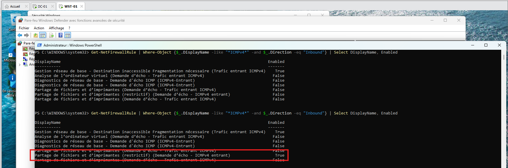
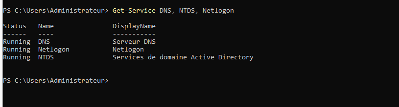
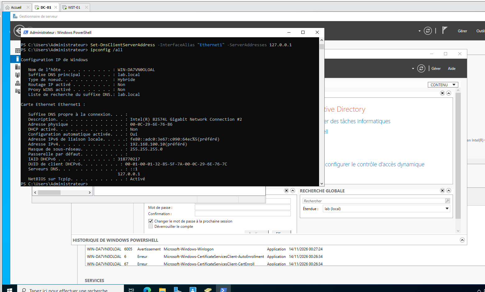
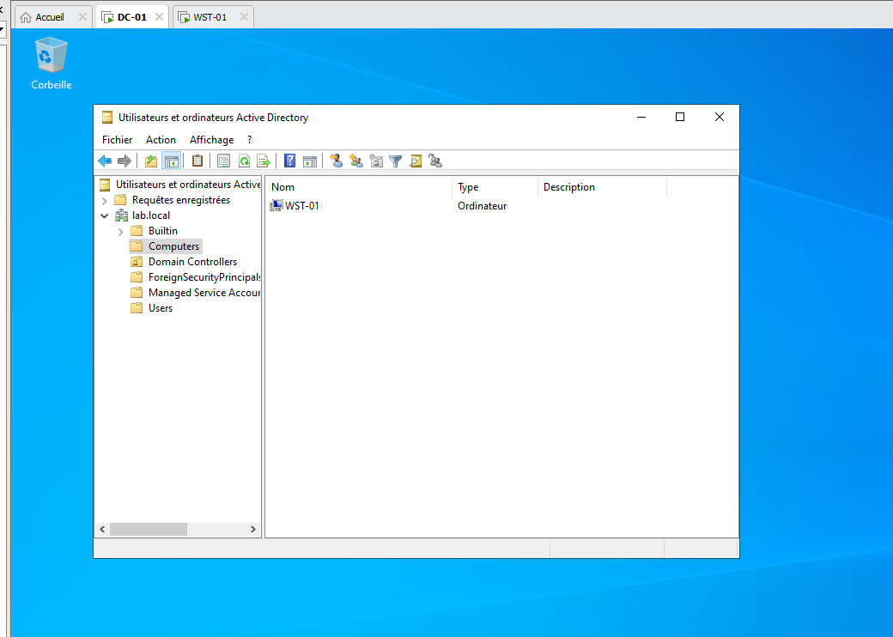

# 01 - AD Core

Statut : en cours (phase 1 du calendrier)

## VM concernees

- **DC-01** (ex WIN-DA7VN0OLOAL, renomme) : Windows Server 2022, controleur de domaine
- **WST-01** : Windows 11 Pro, poste client de test, joint au domaine

## Etapes realisees

### Reseau isole + connectivite

Carte reseau host-only configuree sur les deux VM (192.168.100.0/24, pas de DHCP, IP statiques). Le ping entre DC-01 et WST-01 echouait malgre une config IP correcte : le pare-feu Windows bloque par defaut les requetes ICMPv4 Echo entrantes. Resolu avec une regle pare-feu locale-independante (voir [00-architecture](../00-architecture/README.md#incident-resolu) pour le detail de l'incident).




### Promotion de DC-01 en controleur de domaine

Deux etapes distinctes :

1. **Installation du role AD DS** (`Install-WindowsFeature AD-Domain-Services -IncludeManagementTools`) : copie les binaires du service sur le disque. A ce stade le serveur ne fait encore rien de particulier, le role est juste disponible.
2. **Promotion en controleur de domaine** (`Install-ADDSForest`) : cree la foret `lab.local`, initialise la base d'annuaire (`NTDS.dit`, dans `C:\Windows\NTDS`), demarre les services `NTDS`, `Netlogon` et `DNS`, et configure Kerberos comme protocole d'authentification par defaut du domaine.

```powershell
Install-WindowsFeature -Name AD-Domain-Services -IncludeManagementTools

Install-ADDSForest `
  -DomainName "lab.local" `
  -DomainNetbiosName "LAB" `
  -InstallDns:$true `
  -SafeModeAdministratorPassword (ConvertTo-SecureString "P@$$word" -AsPlainText -Force) `
  -Force:$true
```

Deux avertissements affiches pendant la promotion, non bloquants et attendus pour un lab isole :
- algorithmes de chiffrement compatibles NT4.0 desactives par defaut (point positif cote securite)
- impossible de creer une delegation DNS car aucune zone parente n'existe (normal, il n'y a pas de DNS public au-dessus de ce domaine de lab)

### Pourquoi un controleur de domaine, concretement

Un DC assure 4 roles :

- **Authentification (Kerberos)** : quand une machine du domaine ouvre une session avec un compte AD, c'est le DC qui verifie le mot de passe et delivre un ticket Kerberos (TGT). Ce ticket sert ensuite a prouver l'identite aupres d'autres ressources sans retaper le mot de passe a chaque fois.
- **Annuaire (LDAP)** : le DC repond aux requetes LDAP sur la base `NTDS.dit` (recherche d'utilisateurs, de groupes, d'objets).
- **Replication** : avec plusieurs DC (DC-02 prevu plus tard dans le calendrier), chacun se replique en continu pour garder une base identique.
- **Diffusion des GPO** : le DC distribue les strategies de groupe aux machines du domaine.

### Pourquoi le DNS doit tourner sur le DC lui-meme

Active Directory ne fonctionne pas avec un DNS generique. Pour qu'une machine trouve "ou est le controleur de domaine pour m'authentifier", elle interroge des enregistrements **SRV** speciaux (`_kerberos._tcp.lab.local`, `_ldap._tcp.lab.local`). Ces enregistrements n'existent que dans une zone DNS **integree a Active Directory**, que seul un DC heberge. D'ou la necessite de repointer le client DNS de DC-01 sur lui-meme :

```powershell
Set-DnsClientServerAddress -InterfaceAlias "Ethernet1" -ServerAddresses 127.0.0.1
```

Verification post-promotion et post-reboot :

```powershell
Get-Service DNS, NTDS, Netlogon
Get-ADDomain
```





### Renommage en DC-01

Le serveur portait encore son nom genere automatiquement (`WIN-DA7VN0OLOAL`). Pour un controleur de domaine, on ne fait pas un simple `Rename-Computer` : Microsoft recommande `netdom` pour que le renommage mette a jour proprement les enregistrements DNS et Kerberos associes, sans laisser de references fantomes vers l'ancien nom dans la base AD.

```powershell
netdom computername WIN-DA7VN0OLOAL /add:DC-01.lab.local
netdom computername WIN-DA7VN0OLOAL /makeprimary:DC-01.lab.local
Restart-Computer

# apres redemarrage
netdom computername DC-01.lab.local /enumerate
netdom computername DC-01.lab.local /remove:WIN-DA7VN0OLOAL.lab.local
Restart-Computer
```

### Jonction de WST-01 au domaine

WST-01 n'heberge aucune zone DNS, contrairement a DC-01. Pour resoudre les enregistrements SRV de `lab.local` et trouver un controleur de domaine, son client DNS doit pointer vers DC-01 (pas vers lui-meme, pas vers la passerelle NAT) :

```powershell
# Sur WST-01
Set-DnsClientServerAddress -InterfaceAlias "Ethernet1" -ServerAddresses 192.168.100.10

# Verification avant de tenter le join
Resolve-DnsName lab.local
nslookup -type=srv _ldap._tcp.lab.local

# Jonction au domaine
Add-Computer -DomainName "lab.local" -Credential (Get-Credential) -Restart
```

Apres redemarrage, WST-01 apparait dans le conteneur `Computers` de `lab.local` via la console Utilisateurs et ordinateurs Active Directory sur DC-01.



## Etapes a venir

- Creation manuelle de l'arborescence d'OU (Tier 0/1/2)
- Script PowerShell/Ansible idempotent pour recreer les OU
- CSV de 20-30 utilisateurs realistes + script de creation en masse
- Provisioning DC-02 et verification de la replication
- GPO de durcissement (mot de passe, LAPS, Protected Users)
- Premier scan PingCastle

## captures/

Captures brutes et annotees des etapes ci-dessus.
