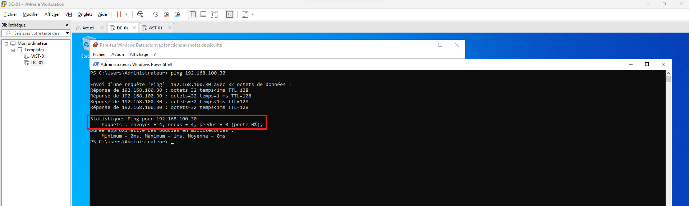
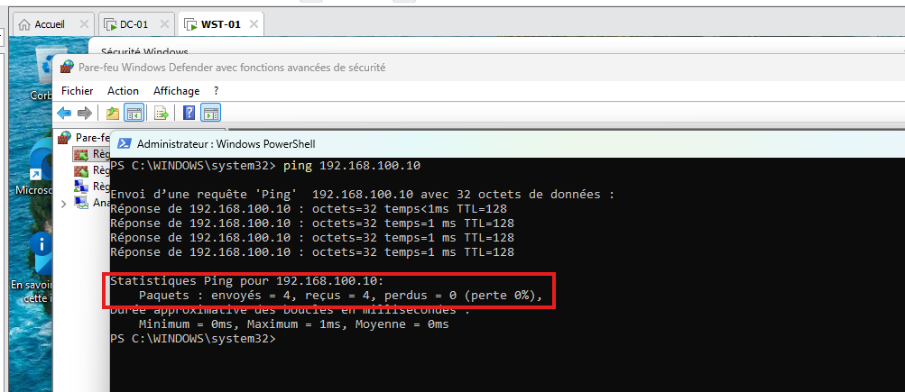
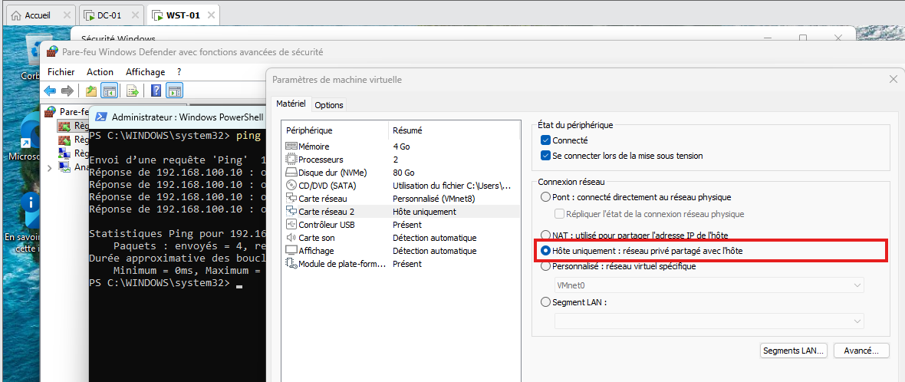
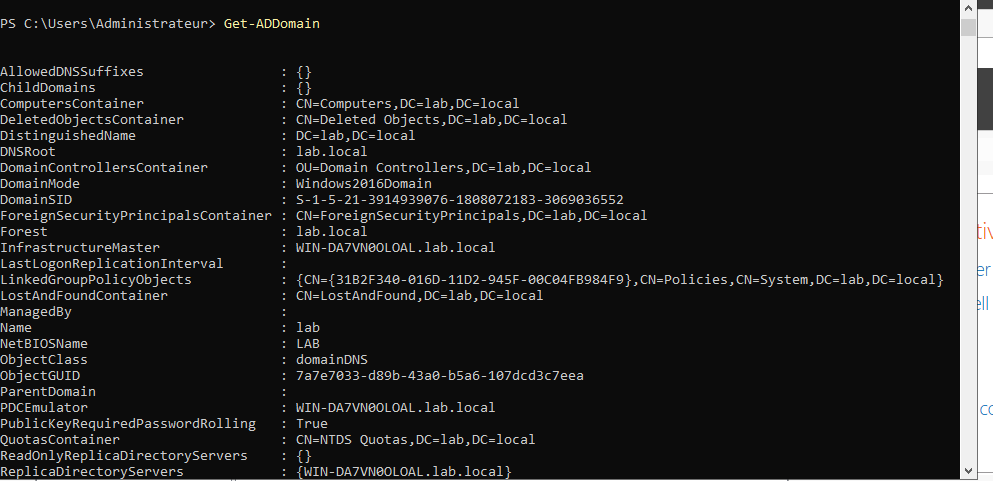
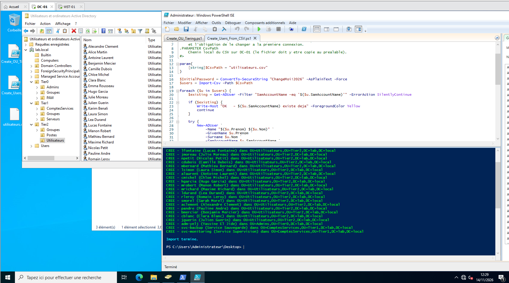
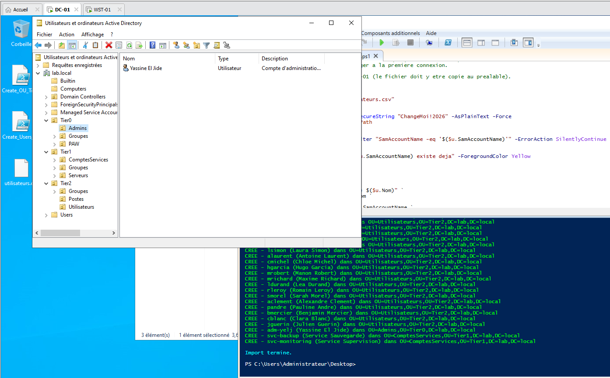
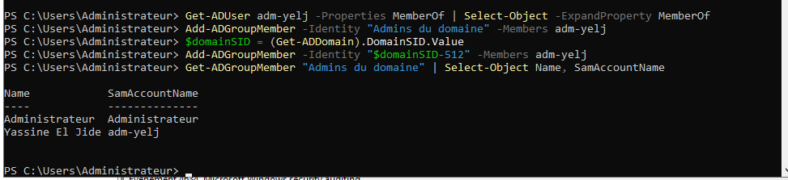

# 01 - AD Core

Statut : en cours (phase 1 du calendrier)

Ce module couvre le coeur de l'annuaire : foret, controleur de domaine, arborescence d'OU/tiering, et cycle de vie des comptes (OU, groupes, utilisateurs). La gestion des postes clients (jonction au domaine, GPO postes) est documentee separement dans [02-postes](../02-postes/README.md).

## VM concernees

- **DC-01** (ex WIN-DA7VN0OLOAL, renomme) : Windows Server 2022, controleur de domaine

## Etapes realisees

### Reseau isole + connectivite

Carte reseau host-only configuree sur les deux VM (192.168.100.0/24, pas de DHCP, IP statiques). Le ping entre DC-01 et WST-01 echouait malgre une config IP correcte : le pare-feu Windows bloque par defaut les requetes ICMPv4 Echo entrantes. Resolu avec une regle pare-feu locale-independante (voir [00-architecture](../00-architecture/README.md#incident-resolu) pour le detail de l'incident).






### Promotion de DC-01 en controleur de domaine

Deux etapes distinctes :

1. **Installation du role AD DS** (`Install-WindowsFeature AD-Domain-Services -IncludeManagementTools`) : copie les binaires du service sur le disque. A ce stade le serveur ne fait encore rien de particulier, le role est juste disponible.
2. **Promotion en controleur de domaine** (`Install-ADDSForest`) : cree la foret `lab.local`, initialise la base d'annuaire (`NTDS.dit`, dans `C:\Windows\NTDS`), demarre les services `NTDS`, `Netlogon` et `DNS`, et configure Kerberos comme protocole d'authentification par defaut du domaine.

```powershell
Install-WindowsFeature -Name AD-Domain-Services -IncludeManagementTools

Install-ADDSForest `
  -DomainName "lab.local" `
  -DomainNetbiosName "LAB" `
  -InstallDns:$true `
  -SafeModeAdministratorPassword (ConvertTo-SecureString "P@$$word" -AsPlainText -Force) `
  -Force:$true
```

Deux avertissements affiches pendant la promotion, non bloquants et attendus pour un lab isole :

Statut : en cours (phase 1 du calendrier)

Ce module couvre le coeur de l'annuaire : foret, controleur de domaine, arborescence d'OU/tiering, et cycle de vie des comptes (OU, groupes, utilisateurs). La gestion des postes clients (jonction au domaine, GPO postes) est documentee separement dans [02-postes](../02-postes/README.md).

## VM concernees

- **DC-01** (ex WIN-DA7VN0OLOAL, renomme) : Windows Server 2022, controleur de domaine

## Etapes realisees

### Reseau isole + connectivite

Carte reseau host-only configuree sur les deux VM (192.168.100.0/24, pas de DHCP, IP statiques). Le ping entre DC-01 et WST-01 echouait malgre une config IP correcte : le pare-feu Windows bloque par defaut les requetes ICMPv4 Echo entrantes. Resolu avec une regle pare-feu locale-independante (voir [00-architecture](../00-architecture/README.md#incident-resolu) pour le detail de l'incident).


### Promotion de DC-01 en controleur de domaine

Deux etapes distinctes :

1. **Installation du role AD DS** (`Install-WindowsFeature AD-Domain-Services -IncludeManagementTools`) : copie les binaires du service sur le disque. A ce stade le serveur ne fait encore rien de particulier, le role est juste disponible.
2. **Promotion en controleur de domaine** (`Install-ADDSForest`) : cree la foret `lab.local`, initialise la base d'annuaire (`NTDS.dit`, dans `C:\Windows\NTDS`), demarre les services `NTDS`, `Netlogon` et `DNS`, et configure Kerberos comme protocole d'authentification par defaut du domaine.

```powershell
Install-WindowsFeature -Name AD-Domain-Services -IncludeManagementTools

Install-ADDSForest `
  -DomainName "lab.local" `
  -DomainNetbiosName "LAB" `
  -InstallDns:$true `
  -SafeModeAdministratorPassword (ConvertTo-SecureString "P@$$word" -AsPlainText -Force) `
  -Force:$true
```

Deux avertissements affiches pendant la promotion, non bloquants et attendus pour un lab isole :
- algorithmes de chiffrement compatibles NT4.0 desactives par defaut (point positif cote securite)
- impossible de creer une delegation DNS car aucune zone parente n'existe (normal, il n'y a pas de DNS public au-dessus de ce domaine de lab)

### Pourquoi un controleur de domaine, concretement

Un DC assure 4 roles :

- **Authentification (Kerberos)** : quand une machine du domaine ouvre une session avec un compte AD, c'est le DC qui verifie le mot de passe et delivre un ticket Kerberos (TGT). Ce ticket sert ensuite a prouver l'identite aupres d'autres ressources sans retaper le mot de passe a chaque fois.
- **Annuaire (LDAP)** : le DC repond aux requetes LDAP sur la base `NTDS.dit` (recherche d'utilisateurs, de groupes, d'objets).
- **Replication** : avec plusieurs DC (DC-02 prevu plus tard dans le calendrier), chacun se replique en continu pour garder une base identique.
- **Diffusion des GPO** : le DC distribue les strategies de groupe aux machines du domaine.

### Pourquoi le DNS doit tourner sur le DC lui-meme

Active Directory ne fonctionne pas avec un DNS generique. Pour qu'une machine trouve "ou est le controleur de domaine pour m'authentifier", elle interroge des enregistrements **SRV** speciaux (`_kerberos._tcp.lab.local`, `_ldap._tcp.lab.local`). Ces enregistrements n'existent que dans une zone DNS **integree a Active Directory**, que seul un DC heberge. D'ou la necessite de repointer le client DNS de DC-01 sur lui-meme :

```powershell
Set-DnsClientServerAddress -InterfaceAlias "Ethernet1" -ServerAddresses 127.0.0.1
```

Verification post-promotion et post-reboot :

```powershell
Get-Service DNS, NTDS, Netlogon
Get-ADDomain
```





### Renommage en DC-01

Le serveur portait encore son nom genere automatiquement (`WIN-DA7VN0OLOAL`). Pour un controleur de domaine, on ne fait pas un simple `Rename-Computer` : Microsoft recommande `netdom` pour que le renommage mette a jour proprement les enregistrements DNS et Kerberos associes, sans laisser de references fantomes vers l'ancien nom dans la base AD.

```powershell
netdom computername WIN-DA7VN0OLOAL /add:DC-01.lab.local
netdom computername WIN-DA7VN0OLOAL /makeprimary:DC-01.lab.local
Restart-Computer

# apres redemarrage
netdom computername DC-01.lab.local /enumerate
netdom computername DC-01.lab.local /remove:WIN-DA7VN0OLOAL.lab.local
Restart-Computer
```

### Arborescence d'OU et modele de tiering (Tier 0/1/2)

**Le probleme que ca resout.** Par defaut, AD range tout dans deux conteneurs plats (`Users`, `Computers`) qui ne distinguent rien par niveau de sensibilite. Un admin qui gere les DC et un utilisateur lambda se retrouvent dans la meme logique de rangement. Le **modele de tiering**, formalise par Microsoft, structure l'annuaire pour limiter le *blast radius* d'une compromission : si un poste utilisateur est infecte, l'attaquant ne doit pas pouvoir remonter jusqu'aux comptes qui administrent la foret.

**La regle centrale du tiering :** un compte d'un tier ne doit jamais s'authentifier sur une machine d'un tier inferieur. Concretement, un admin Tier 0 (DC) ne se connecte jamais avec son compte admin sur un poste Tier 2, meme pour depanner : si ce poste est compromis, l'attaquant peut extraire les identifiants de toute session ouverte en memoire (credential dumping, type Mimikatz) et remonter jusqu'a la foret entiere. C'est le scenario classique de **mouvement lateral** qu'on attaquera nous-memes en phase 3 (attaque AD) du calendrier.

- **Tier 0** : les objets qui controlent entierement la foret -- les DC eux-memes, les comptes qui les administrent, et plus tard les PAW (Privileged Access Workstation, postes dedies et durcis reserves a l'administration Tier 0)
- **Tier 1** : les serveurs applicatifs (futurs serveurs de fichiers, bases de donnees, Keycloak...) et les comptes de service qui les gerent
- **Tier 2** : les postes utilisateurs standards et les comptes utilisateurs classiques

**Utilite de chaque sous-OU :**

| OU | Contenu | Pourquoi une OU dediee |
|---|---|---|
| `Tier0/Admins` | Comptes d'administration de la foret/du domaine | Isoles pour appliquer des GPO de restriction specifiques (ex: interdiction de login sur Tier 1/2) et des strategies de mot de passe renforcees |
| `Tier0/Groupes` | Groupes de securite donnant des droits Tier 0 | Permet de deleguer des droits d'administration de maniere groupee plutot que par compte individuel |
| `Tier0/PAW` | Postes dedies a l'administration des DC | Un PAW n'a jamais acces a Internet ni aux emails -- reduit la surface d'attaque pour les comptes les plus sensibles |
| `Tier1/Serveurs` | Objets ordinateur des serveurs applicatifs | Separe les GPO de durcissement serveur des GPO postes utilisateurs |
| `Tier1/ComptesServices` | Comptes utilises par les applications/services (pas des humains) | Les comptes de service ont des besoins differents (pas d'expiration de mot de passe interactive, droits limites a une tache) |
| `Tier1/Groupes` | Groupes de securite Tier 1 | Meme logique que Tier0/Groupes, perimetre limite aux serveurs |
| `Tier2/Postes` | Objets ordinateur des postes utilisateurs (WST-01 ici) | GPO de poste de travail standard (restrictions utilisateur, durcissement de base) |
| `Tier2/Utilisateurs` | Comptes utilisateurs humains standards | Comptes de test crees au Jour 9 (voir plus bas) |
| `Tier2/Groupes` | Groupes de securite Tier 2 | Gestion des droits metier (acces fichiers, applications) sans toucher aux droits d'administration |

Le flag `-ProtectedFromAccidentalDeletion $true` sur chaque OU pose une ACL deny-delete : pratique standard en production pour eviter qu'une suppression accidentelle d'OU n'emporte toutes les sous-OU et objets avec elle.

```powershell
# OU racines
New-ADOrganizationalUnit -Name "Tier0" -Path "DC=lab,DC=local" -ProtectedFromAccidentalDeletion $true
New-ADOrganizationalUnit -Name "Tier1" -Path "DC=lab,DC=local" -ProtectedFromAccidentalDeletion $true
New-ADOrganizationalUnit -Name "Tier2" -Path "DC=lab,DC=local" -ProtectedFromAccidentalDeletion $true

# Sous-OU Tier0
New-ADOrganizationalUnit -Name "Admins"  -Path "OU=Tier0,DC=lab,DC=local" -ProtectedFromAccidentalDeletion $true
New-ADOrganizationalUnit -Name "Groupes" -Path "OU=Tier0,DC=lab,DC=local" -ProtectedFromAccidentalDeletion $true
New-ADOrganizationalUnit -Name "PAW"     -Path "OU=Tier0,DC=lab,DC=local" -ProtectedFromAccidentalDeletion $true

# Sous-OU Tier1
New-ADOrganizationalUnit -Name "Serveurs"        -Path "OU=Tier1,DC=lab,DC=local" -ProtectedFromAccidentalDeletion $true
New-ADOrganizationalUnit -Name "ComptesServices" -Path "OU=Tier1,DC=lab,DC=local" -ProtectedFromAccidentalDeletion $true
New-ADOrganizationalUnit -Name "Groupes"         -Path "OU=Tier1,DC=lab,DC=local" -ProtectedFromAccidentalDeletion $true

# Sous-OU Tier2
New-ADOrganizationalUnit -Name "Postes"        -Path "OU=Tier2,DC=lab,DC=local" -ProtectedFromAccidentalDeletion $true
New-ADOrganizationalUnit -Name "Utilisateurs"  -Path "OU=Tier2,DC=lab,DC=local" -ProtectedFromAccidentalDeletion $true
New-ADOrganizationalUnit -Name "Groupes"       -Path "OU=Tier2,DC=lab,DC=local" -ProtectedFromAccidentalDeletion $true
```


A noter : Microsoft a fait evoluer ce modele Tier 0/1/2 (2016) vers l'**Enterprise Access Model** (depuis ~2019), plus granulaire (Control Plane / Management Plane / Data Plane). Le tiering classique reste largement utilise et compris, donc choisi comme base pour ce lab.

### Script idempotent de creation des OU

Les commandes `New-ADOrganizationalUnit` ci-dessus plantent si on les relance (l'OU existe deja). Un script **idempotent** verifie l'etat actuel avant d'agir : il peut etre relance a volonte sans erreur ni effet de bord. C'est le meme principe que Terraform ou Ansible (convergence declarative) -- un bon reflexe a montrer plutot que de la simple commande ponctuelle.

Script disponible dans [`scripts/create-ou-tiering.ps1`](scripts/create-ou-tiering.ps1). Il utilise `(Get-ADDomain).DistinguishedName` plutot qu'un `DC=lab,DC=local` code en dur, pour rester reutilisable sur un autre domaine. Chaque OU est verifiee via `Get-ADOrganizationalUnit -Filter` avant creation.

Teste par une double execution : le premier run confirme que l'arborescence existante est bien detectee, le second (capture ci-dessous) confirme qu'aucune erreur n'est levee et que tout ressort en "OK - existe deja".


### CSV et creation en masse des utilisateurs

**Pourquoi un CSV plutot que des `New-ADUser` tapees a la main ?** Parce que c'est comme ca que ca se passe en entreprise : les RH exportent une liste d'arrivees depuis leur SIRH, et le provisioning IAM consomme ce fichier. Separer la donnee (qui sont ces gens) du script (comment on les cree) permet de rejouer la creation sur n'importe quel import sans retoucher le code.

CSV disponible dans [`data/utilisateurs.csv`](data/utilisateurs.csv) : 27 comptes repartis volontairement sur les 3 tiers -- 24 utilisateurs standards (`Tier2/Utilisateurs`, departements varies : IT, Finance, RH, Commercial, Marketing, Production, Qualite, Logistique, Juridique), 1 compte admin nominatif (`adm-yelj`, dans `Tier0/Admins`, jamais confondu avec le compte `Administrateur` integre), et 2 comptes de service (`Tier1/ComptesServices`).

Script de creation dans [`scripts/create-users-from-csv.ps1`](scripts/create-users-from-csv.ps1), idempotent lui aussi (`Get-ADUser -Filter` avant chaque creation). Chaque compte recoit un mot de passe initial avec `-ChangePasswordAtLogon $true` : le mot de passe de depart est volontairement faible mais personne ne peut l'utiliser au-dela de la premiere connexion.




### Correction : adm-yelj n'etait pas reellement admin (OU != groupe)

Point identifie en cours de route : `adm-yelj` a ete cree directement dans `OU=Admins,OU=Tier0` par le script de creation en masse, mais celui-ci ne definit que l'OU (`-Path`) - **une OU est purement organisationnelle, elle ne donne aucun droit**. Seule l'appartenance a un groupe (ici `Domain Admins`, affiche `Admins du domaine` sur un AD en francais) accorde un privilege reel. Jusqu'a cette correction, `adm-yelj` n'etait donc administrateur de rien, malgre son placement dans l'OU Tier0.

Correction appliquee :

```powershell
Add-ADGroupMember -Identity "Admins du domaine" -Members adm-yelj
```

Point technique annexe : les noms des groupes integres sont traduits selon la langue du serveur (`Domain Admins` -> `Admins du domaine`), mais leur identifiant reel (RID) ne change jamais - `512` pour Domain Admins, quelle que soit la langue. Une alternative independante de la langue :

```powershell
$domainSID = (Get-ADDomain).DomainSID.Value
Add-ADGroupMember -Identity "$domainSID-512" -Members adm-yelj
```

Verification - `adm-yelj` apparait maintenant aux cotes du compte `Administrateur` integre :



## Etapes a venir

- Groupes de securite par tier et premieres delegations
- Provisioning DC-02 et verification de la replication
- GPO de durcissement (mot de passe, LAPS, Protected Users, restriction de login par tier)
- Premier scan PingCastle

## captures/

Captures brutes et annotees des etapes ci-dessus.

## scripts/

Scripts idempotents reutilisables pour reconstruire cette partie du lab.

## data/

Jeux de donnees (CSV) consommes par les scripts.
