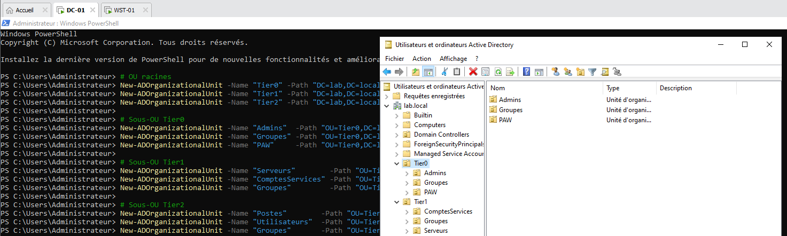
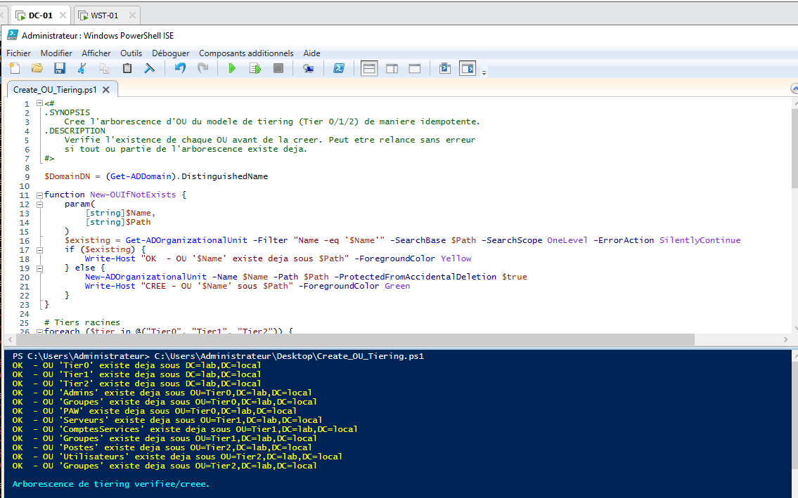

# Tiering et arborescence d'OU

[Retour a l'index 01-ad-core](../README.md)

### Arborescence d'OU et modele de tiering (Tier 0/1/2)

**Le probleme que ca resout.** Par defaut, AD range tout dans deux conteneurs plats (`Users`, `Computers`) qui ne distinguent rien par niveau de sensibilite. Un admin qui gere les DC et un utilisateur lambda se retrouvent dans la meme logique de rangement. Le **modele de tiering**, formalise par Microsoft, structure l'annuaire pour limiter le *blast radius* d'une compromission : si un poste utilisateur est infecte, l'attaquant ne doit pas pouvoir remonter jusqu'aux comptes qui administrent la foret.

**La regle centrale du tiering :** un compte d'un tier ne doit jamais s'authentifier sur une machine d'un tier inferieur. Concretement, un admin Tier 0 (DC) ne se connecte jamais avec son compte admin sur un poste Tier 2, meme pour depanner : si ce poste est compromis, l'attaquant peut extraire les identifiants de toute session ouverte en memoire (credential dumping, type Mimikatz) et remonter jusqu'a la foret entiere. C'est le scenario classique de **mouvement lateral** qu'on attaquera nous-memes en phase 3 (attaque AD) du calendrier.

- **Tier 0** : les objets qui controlent entierement la foret -- les DC eux-memes, les comptes qui les administrent, et plus tard les PAW (Privileged Access Workstation, postes dedies et durcis reserves a l'administration Tier 0)
- **Tier 1** : les serveurs applicatifs (futurs serveurs de fichiers, bases de donnees, Keycloak...) et les comptes de service qui les gerent
- **Tier 2** : les postes utilisateurs standards et les comptes utilisateurs classiques

**Utilite de chaque sous-OU :**

| OU | Contenu | Pourquoi une OU dediee |
|---|---|---|
| `Tier0/Admins` | Comptes d'administration de la foret/du domaine | Isoles pour appliquer des GPO de restriction specifiques (ex: interdiction de login sur Tier 1/2) et des strategies de mot de passe renforcees |
| `Tier0/Groupes` | Groupes de securite donnant des droits Tier 0 | Permet de deleguer des droits d'administration de maniere groupee plutot que par compte individuel |
| `Tier0/PAW` | Postes dedies a l'administration des DC | Un PAW n'a jamais acces a Internet ni aux emails -- reduit la surface d'attaque pour les comptes les plus sensibles |
| `Tier1/Serveurs` | Objets ordinateur des serveurs applicatifs | Separe les GPO de durcissement serveur des GPO postes utilisateurs |
| `Tier1/ComptesServices` | Comptes utilises par les applications/services (pas des humains) | Les comptes de service ont des besoins differents (pas d'expiration de mot de passe interactive, droits limites a une tache) |
| `Tier1/Groupes` | Groupes de securite Tier 1 | Meme logique que Tier0/Groupes, perimetre limite aux serveurs |
| `Tier2/Postes` | Objets ordinateur des postes utilisateurs (WST-01 ici) | GPO de poste de travail standard (restrictions utilisateur, durcissement de base) |
| `Tier2/Utilisateurs` | Comptes utilisateurs humains standards | Comptes de test crees au Jour 9 (voir plus bas) |
| `Tier2/Groupes` | Groupes de securite Tier 2 | Gestion des droits metier (acces fichiers, applications) sans toucher aux droits d'administration |

Le flag `-ProtectedFromAccidentalDeletion $true` sur chaque OU pose une ACL deny-delete : pratique standard en production pour eviter qu'une suppression accidentelle d'OU n'emporte toutes les sous-OU et objets avec elle.

```powershell
# OU racines
New-ADOrganizationalUnit -Name "Tier0" -Path "DC=lab,DC=local" -ProtectedFromAccidentalDeletion $true
New-ADOrganizationalUnit -Name "Tier1" -Path "DC=lab,DC=local" -ProtectedFromAccidentalDeletion $true
New-ADOrganizationalUnit -Name "Tier2" -Path "DC=lab,DC=local" -ProtectedFromAccidentalDeletion $true

# Sous-OU Tier0
New-ADOrganizationalUnit -Name "Admins"  -Path "OU=Tier0,DC=lab,DC=local" -ProtectedFromAccidentalDeletion $true
New-ADOrganizationalUnit -Name "Groupes" -Path "OU=Tier0,DC=lab,DC=local" -ProtectedFromAccidentalDeletion $true
New-ADOrganizationalUnit -Name "PAW"     -Path "OU=Tier0,DC=lab,DC=local" -ProtectedFromAccidentalDeletion $true

# Sous-OU Tier1
New-ADOrganizationalUnit -Name "Serveurs"        -Path "OU=Tier1,DC=lab,DC=local" -ProtectedFromAccidentalDeletion $true
New-ADOrganizationalUnit -Name "ComptesServices" -Path "OU=Tier1,DC=lab,DC=local" -ProtectedFromAccidentalDeletion $true
New-ADOrganizationalUnit -Name "Groupes"         -Path "OU=Tier1,DC=lab,DC=local" -ProtectedFromAccidentalDeletion $true

# Sous-OU Tier2
New-ADOrganizationalUnit -Name "Postes"        -Path "OU=Tier2,DC=lab,DC=local" -ProtectedFromAccidentalDeletion $true
New-ADOrganizationalUnit -Name "Utilisateurs"  -Path "OU=Tier2,DC=lab,DC=local" -ProtectedFromAccidentalDeletion $true
New-ADOrganizationalUnit -Name "Groupes"       -Path "OU=Tier2,DC=lab,DC=local" -ProtectedFromAccidentalDeletion $true
```



A noter : Microsoft a fait evoluer ce modele Tier 0/1/2 (2016) vers l'**Enterprise Access Model** (depuis ~2019), plus granulaire (Control Plane / Management Plane / Data Plane). Le tiering classique reste largement utilise et compris, donc choisi comme base pour ce lab.

### Script idempotent de creation des OU

Les commandes `New-ADOrganizationalUnit` ci-dessus plantent si on les relance (l'OU existe deja). Un script **idempotent** verifie l'etat actuel avant d'agir : il peut etre relance a volonte sans erreur ni effet de bord. C'est le meme principe que Terraform ou Ansible (convergence declarative) -- un bon reflexe a montrer plutot que de la simple commande ponctuelle.

Script disponible dans [`scripts/create-ou-tiering.ps1`](../scripts/create-ou-tiering.ps1). Il utilise `(Get-ADDomain).DistinguishedName` plutot qu'un `DC=lab,DC=local` code en dur, pour rester reutilisable sur un autre domaine. Chaque OU est verifiee via `Get-ADOrganizationalUnit -Filter` avant creation.

Teste par une double execution : le premier run confirme que l'arborescence existante est bien detectee, le second (capture ci-dessous) confirme qu'aucune erreur n'est levee et que tout ressort en "OK - existe deja".


