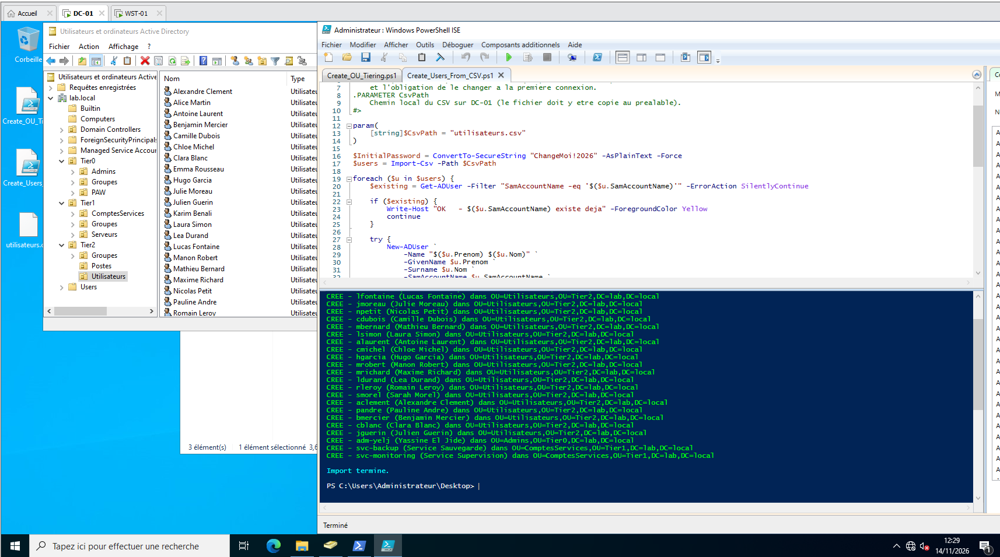
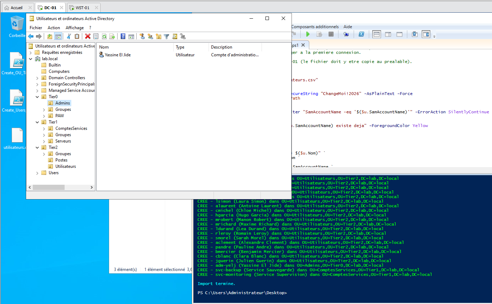
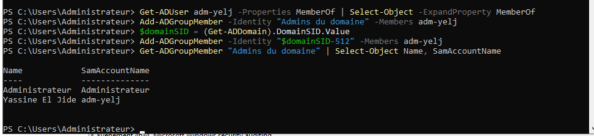

# Provisioning des utilisateurs et correction adm-yelj

[Retour a l'index 01-ad-core](../README.md)

### CSV et creation en masse des utilisateurs

**Pourquoi un CSV plutot que des `New-ADUser` tapees a la main ?** Parce que c'est comme ca que ca se passe en entreprise : les RH exportent une liste d'arrivees depuis leur SIRH, et le provisioning IAM consomme ce fichier. Separer la donnee (qui sont ces gens) du script (comment on les cree) permet de rejouer la creation sur n'importe quel import sans retoucher le code.

CSV disponible dans [`data/utilisateurs.csv`](../data/utilisateurs.csv) : 27 comptes repartis volontairement sur les 3 tiers -- 24 utilisateurs standards (`Tier2/Utilisateurs`, departements varies : IT, Finance, RH, Commercial, Marketing, Production, Qualite, Logistique, Juridique), 1 compte admin nominatif (`adm-yelj`, dans `Tier0/Admins`, jamais confondu avec le compte `Administrateur` integre), et 2 comptes de service (`Tier1/ComptesServices`).

Script de creation dans [`scripts/create-users-from-csv.ps1`](../scripts/create-users-from-csv.ps1), idempotent lui aussi (`Get-ADUser -Filter` avant chaque creation). Chaque compte recoit un mot de passe initial avec `-ChangePasswordAtLogon $true` : le mot de passe de depart est volontairement faible mais personne ne peut l'utiliser au-dela de la premiere connexion.




### Correction : adm-yelj n'etait pas reellement admin (OU != groupe)

Point identifie en cours de route : `adm-yelj` a ete cree directement dans `OU=Admins,OU=Tier0` par le script de creation en masse, mais celui-ci ne definit que l'OU (`-Path`) - **une OU est purement organisationnelle, elle ne donne aucun droit**. Seule l'appartenance a un groupe (ici `Domain Admins`, affiche `Admins du domaine` sur un AD en francais) accorde un privilege reel. Jusqu'a cette correction, `adm-yelj` n'etait donc administrateur de rien, malgre son placement dans l'OU Tier0.

Correction appliquee :

```powershell
Add-ADGroupMember -Identity "Admins du domaine" -Members adm-yelj
```

Point technique annexe : les noms des groupes integres sont traduits selon la langue du serveur (`Domain Admins` -> `Admins du domaine`), mais leur identifiant reel (RID) ne change jamais - `512` pour Domain Admins, quelle que soit la langue. Une alternative independante de la langue :

```powershell
$domainSID = (Get-ADDomain).DomainSID.Value
Add-ADGroupMember -Identity "$domainSID-512" -Members adm-yelj
```

Verification - `adm-yelj` apparait maintenant aux cotes du compte `Administrateur` integre :


