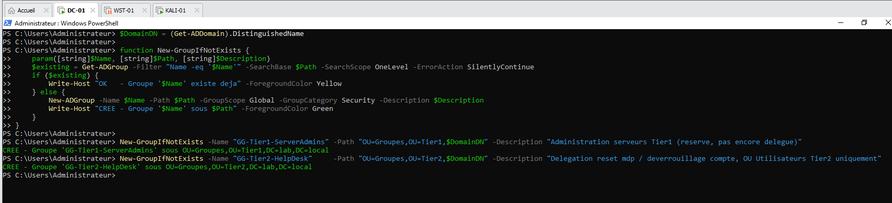
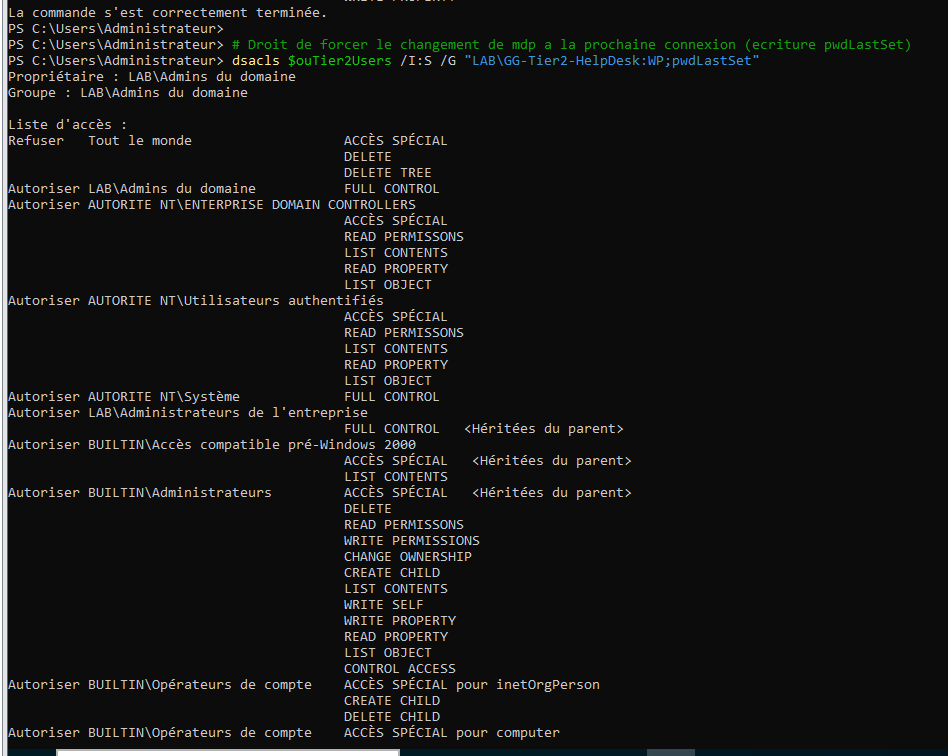
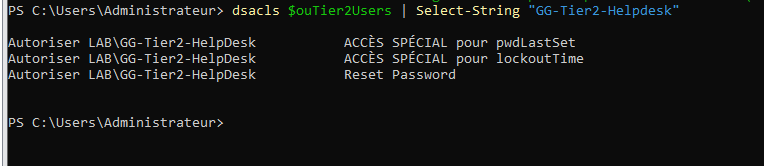

# Groupes de securite par tier et delegation

[Retour a l'index 01-ad-core](../README.md)

### Groupes de securite par tier et premiere delegation

**Le probleme que ca resout.** On vient de mettre `adm-yelj` directement dans `Admins du domaine` - correct pour un compte Tier0, c'est sa raison d'etre. Mais si chaque besoin d'administration (meme mineur, comme reinitialiser un mot de passe) passe par un ajout a Domain Admins, on retombe dans le piege demontre par l'attaque LDAP du module 03 : plus il y a de comptes a privilege large, plus la surface d'attaque est grosse. Le principe de delegation AD : un besoin specifique ne necessite pas un privilege large, on scope le droit exactement a ce qui est necessaire, sur l'OU necessaire.

**Design retenu**, en s'appuyant sur les sous-OU `Groupes` deja presentes dans chaque tier :
- `GG-Tier1-ServerAdmins` (dans `OU=Groupes,OU=Tier1`) : reserve pour l'administration des futurs serveurs Tier1 (DC-02, etc.), pas encore delegue.
- `GG-Tier2-HelpDesk` (dans `OU=Groupes,OU=Tier2`) : delegation reelle et testee - reset mot de passe + deverrouillage de compte, **uniquement sur `OU=Utilisateurs,OU=Tier2`**.

Tier0 n'a pas besoin d'un groupe supplementaire : `Admins du domaine` est deja le groupe de controle de Tier0.

Script idempotent : [scripts/create-tier-groups.ps1](../scripts/create-tier-groups.ps1).



**Delegation via `dsacls`.** `dsacls` lit et modifie directement le descripteur de securite (ACL) d'un objet AD - l'equivalent en ligne de commande de l'onglet Securite/Avance dans ADUC. Trois droits accordes, volontairement granulaires plutot qu'un `GenericWrite` qui ouvrirait trop de portes :

```powershell
$ouTier2Users = "OU=Utilisateurs,OU=Tier2,$((Get-ADDomain).DistinguishedName)"

dsacls $ouTier2Users /I:S /G "LAB\GG-Tier2-HelpDesk:CA;Reset Password"   # droit etendu de reinitialiser le mot de passe
dsacls $ouTier2Users /I:S /G "LAB\GG-Tier2-HelpDesk:WP;lockoutTime"     # ecriture de l'attribut qui deverrouille un compte
dsacls $ouTier2Users /I:S /G "LAB\GG-Tier2-HelpDesk:WP;pwdLastSet"      # ecriture de l'attribut qui force le changement de mdp a la prochaine connexion
```

`/I:S` = l'autorisation s'applique aux sous-objets (les utilisateurs de l'OU), pas seulement a l'OU elle-meme. `CA` = Control Access Right (droit etendu). `WP` = Write Property (ecriture d'un attribut precis).

Point important a noter sur la sortie de `dsacls` : la commande n'affiche pas seulement le droit qu'on vient d'ajouter, elle reaffiche **toute l'ACL existante de l'objet**, entrees par defaut comprises (Domain Admins, SYSTEM, Enterprise Admins, Account Operators, etc.). Rien d'anormal - c'est le comportement normal de l'outil. On y retrouve d'ailleurs une ligne qui fait echo direct a l'attaque du module 03 : `Autorise Utilisateurs authentifies : READ PERMISSIONS, LIST CONTENTS, READ PROPERTY, LIST OBJECT` - exactement le droit par defaut qu'on a exploite avec `ldapsearch`.



Verification ciblee (plus lisible qu'un dump complet) :

```powershell
dsacls $ouTier2Users | Select-String "GG-Tier2-HelpDesk"
```



Prochaine etape pour clore ce point : ajouter un compte test (pas `adm-yelj`) dans `GG-Tier2-HelpDesk` et verifier qu'il peut reinitialiser le mot de passe d'un utilisateur Tier2 sans etre admin du domaine, ni pouvoir toucher a autre chose.
