# Audit PingCastle - baseline et plan de remediation

[Retour a l'index 01-ad-core](../README.md)

## Quoi et pourquoi

[PingCastle](https://www.pingcastle.com/) est l'outil de reference pour auditer la securite d'un Active Directory. Il analyse le domaine et produit un score de risque par categorie (0 = parfait, plus c'est haut, pire c'est), avec un rapport detaille et des recommandations pour chaque point souleve. L'interet pour ce lab : avoir une note chiffree et traçable, pour documenter une vraie progression (comme on l'a deja fait a petite echelle avec `lockoutThreshold`), plutot qu'une simple liste de bonnes intentions.

## Comment (execution)

Sur DC-01, version gratuite telechargee depuis [pingcastle.com](https://www.pingcastle.com/download/) (via la carte NAT), executee sans installation :

```powershell
.\PingCastle.exe --healthcheck --server lab.local
```


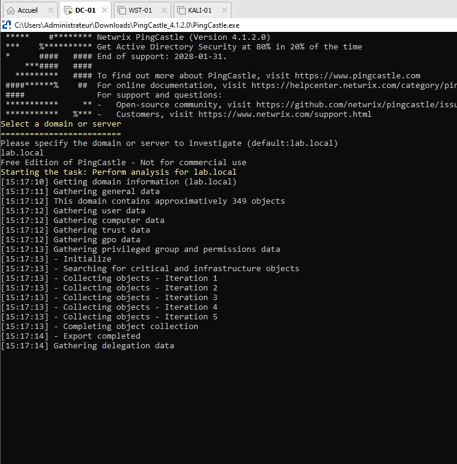

Rapport complet (HTML, interactif) : [pingcastle/rapport-pingcastle-2026-11-15.html](../pingcastle/rapport-pingcastle-2026-11-15.html)

## Resultat - baseline du 2026-11-15

**Score de risque global : 55 / 100** (le score du domaine est le maximum des 4 categories, pas une moyenne - une seule categorie mauvaise suffit a plomber la note globale)


| Categorie | Score | Regles matchees | Ce que ca couvre |
|---|---|---|---|
| Stale Objects | 40/100 | 10 / 56 | Operations liees aux objets utilisateur/ordinateur |
| Privileged Accounts | 50/100 | 5 / 48 | Administrateurs de l'annuaire |
| Trusts | 0/100 | 0 / 12 | Relations avec d'autres domaines (non applicable, un seul domaine) |
| Anomalies | 55/100 | 14 / 77 | Points de controle de securite specifiques |


## Detail des regles qui comptent des points (les 0-point/informatives ne sont pas listees ici, elles sont dans le rapport complet)

### Stale Objects (40 pts)

| Regle | Points | Constat |
|---|---|---|
| S-OldNtlm | 15 | NTLMv1/LM acceptes par les DC (pas de GPO definissant le niveau d'authentification LAN Manager) |
| S-AesNotEnabled | 10 | Le compte `Administrateur` n'a pas AES active pour Kerberos (reste sur RC4) |
| S-ADRegistration | 10 | Tout utilisateur standard peut ajouter jusqu'a 10 ordinateurs au domaine (`ms-DS-MachineAccountQuota` par defaut) |
| S-DC-SubnetMissing | 5 | Le sous-reseau 192.168.100.0/24 n'est pas declare dans AD Sites and Services |

### Privileged Accounts (50 pts)

| Regle | Points | Constat |
|---|---|---|
| P-Delegated | 20 | `Administrateur` et `adm-yelj` n'ont pas le flag "compte sensible, ne peut pas etre delegue" |
| P-ProtectedUsers | 10 | Aucun des deux comptes admin n'est dans le groupe `Protected Users` |
| P-SchemaAdmin | 10 | Le groupe `Schema Admins` n'est pas vide (1 compte, probablement `Administrateur` par defaut) |
| P-RecycleBin | 10 | La corbeille AD (Recycle Bin) n'est pas activee |

### Anomalies (55 pts)

| Regle | Points | Constat |
|---|---|---|
| A-LAPS-Not-Installed | 15 | LAPS non deploye (deja identifie plus tot dans le projet) |
| A-AuditDC | 10 | La politique d'audit attendue sur les DC n'est pas en place |
| A-DC-Spooler | 10 | Le service Spooler (impression) tourne sur le DC - exploitable (PrintNightmare) |
| A-MinPwdLen | 10 | Longueur minimale de mot de passe trop faible (7, deja repere pendant l'attaque LDAP du module 03) |
| A-NotEnoughDC | 5 | Un seul DC - pas de redondance (DC-02 deja prevu) |
| A-HardenedPaths | 5 | Pas de durcissement des chemins UNC (SYSVOL/NETLOGON) |

## Plan de remediation, par ordre de priorite

Priorite donnee aux correctifs rapides et a faible risque d'abord (une commande, pas d'impact fonctionnel attendu), puis aux correctifs qui demandent plus de prudence ou une GPO.

### A faire en premier (gains rapides, faible risque) - FAIT le 2026-11-17

1. [x] **P-RecycleBin** - `Enable-ADOptionalFeature -Identity 'Recycle Bin Feature' -Scope ForestOrConfigurationSet -Target lab.local` - corrige, confirme par le re-scan
2. [x] **S-ADRegistration** - `Set-ADDomain -Identity lab.local -Replace @{"ms-DS-MachineAccountQuota"=0}` - corrige, confirme par le re-scan
3. [x] **P-SchemaAdmin** - retrait via le RID (518) plutot que le nom (voir section resultat detaille) - corrige, confirme par le re-scan
4. [ ] **S-AesNotEnabled** - fait sur `Administrateur`, **pas encore sur `adm-yelj`** - regle toujours active, a corriger
5. [x] **A-DC-Spooler** - `Stop-Service -Name Spooler -Force; Set-Service -Name Spooler -StartupType Disabled` - corrige, confirme par le re-scan
6. [ ] **S-DC-SubnetMissing** - un sous-reseau declare, **mais DC-01 a 2 IP** - a verifier/completer

### A faire ensuite (impact fonctionnel a verifier avant d'appliquer)

7. **A-MinPwdLen** - remonter `MinPasswordLength` (ex: 14) via `Set-ADDefaultDomainPasswordPolicy`
8. **P-Delegated + P-ProtectedUsers** (30 pts cumules) - ajouter `adm-yelj` (et prudemment `Administrateur`) au groupe `Protected Users` - attention, ce groupe force Kerberos pur (plus de NTLM, plus de cache d'identifiants, plus de delegation) : a tester d'abord sur `adm-yelj` seul pour ne pas se retrouver bloque
9. [x] **S-OldNtlm** - GPO "Network security: LAN Manager authentication level" -> "Send NTLMv2 response only. Refuse LM & NTLM" - corrige le 2026-11-17, confirme par le re-scan (voir section Palier 2)
10. **A-HardenedPaths** - GPO durcissement des chemins UNC SYSVOL/NETLOGON

### Deja planifie ailleurs dans le projet

- [x] **A-LAPS-Not-Installed** - deploye le 2026-11-20 (voir section Palier 3), confirme par le re-scan
- **A-NotEnoughDC** - sera resolu par le provisioning de DC-02

## Suivi de la progression

| Date | Score global | Stale | Privileged | Trusts | Anomalies | Notes |
|---|---|---|---|---|---|---|
| 2026-11-15 | 55/100 | 40/100 | 50/100 | 0/100 | 55/100 | Baseline, avant tout correctif |
| 2026-11-17 | 45/100 | 30/100 | 30/100 | 0/100 | 45/100 | Apres le palier 1 (6 corrections rapides) |
| 2026-11-17 | 45/100 | **15/100** | 30/100 | 0/100 | 45/100 | Apres le palier 2 (GPO durcissement NTLM) - `S-OldNtlm` corrige, score global inchange car plafonne par Anomalies (voir explication plus bas) |
| 2026-11-20 | **30/100** | 15/100 | 30/100 | 0/100 | **30/100** | Apres le palier 3 (deploiement Windows LAPS) - `A-LAPS-Not-Installed` corrige, **premier vrai mouvement du score global** (45 -> 30) |


## Palier 1 - resultat detaille (2026-11-17)

Les 6 corrections ont ete executees sur DC-01, en PowerShell eleve (session Administrateur) :


| # | Correctif | Commande | Resultat |
|---|---|---|---|
| 1 | Corbeille AD activee | `Enable-ADOptionalFeature 'Recycle Bin Feature' ...` | OK - confirme par `EnabledScopes` non vide |
| 2 | Quota machine a 0 | `Set-ADDomain ... ms-DS-MachineAccountQuota=0` | OK |
| 3 | Schema Admins vide | `Remove-ADGroupMember` (via le RID, voir plus bas) | OK - groupe vide, verifie |
| 4 | AES sur Administrateur | `Set-ADUser Administrateur ... msDS-SupportedEncryptionTypes=24` | Execute, mais **le score ne bouge pas encore** (voir note) |
| 5 | Spooler desactive sur le DC | `Stop-Service` + `Set-Service -StartupType Disabled` | OK |
| 6 | Sous-reseau declare | `New-ADReplicationSubnet` | Execute, mais **le score ne bouge pas encore** (voir note) |


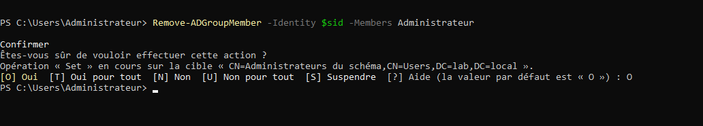

**Petit aparte linguistique.** Le nom reel du groupe en francais n'est ni `Schema Admins` ni l'hypothese initiale `Admins du schema` - c'est **`Administrateurs du schema`**. Les deux premieres tentatives ont echoue (`ObjectNotFoundException`), pas a cause d'un probleme d'accent comme soupçonne au depart, mais a cause d'une mauvaise traduction. Solution retenue : utiliser le RID (518, independant de toute langue) plutot que de deviner le bon nom :

```powershell
$sid = (Get-ADDomain).DomainSID.Value + "-518"
Get-ADGroupMember -Identity $sid
Remove-ADGroupMember -Identity $sid -Members Administrateur
```

**Score : 55 -> 45/100.** Le detail par categorie confirme precisement quelles regles ont ete levees :

| Categorie | Avant | Apres | Regles matchees avant/apres | Explication |
|---|---|---|---|---|
| Stale Objects | 40 | 30 | 10 -> 9 | -10 pts = `S-ADRegistration` corrige. `S-AesNotEnabled` (10 pts) et `S-DC-SubnetMissing` (5 pts) sont toujours actives malgre les commandes executees (voir ci-dessous) |
| Privileged Accounts | 50 | 30 | 5 -> 3 | -20 pts = `P-RecycleBin` + `P-SchemaAdmin` corriges, les deux a 100% |
| Trusts | 0 | 0 | 0 -> 0 | Inchange, attendu (domaine unique) |
| Anomalies | 55 | 45 | 14 -> 13 | -10 pts = `A-DC-Spooler` corrige |

**Pourquoi AES et le sous-reseau n'ont pas encore fait bouger le score :**

- `S-AesNotEnabled` verifie vraisemblablement **tous les comptes privilegies**, pas seulement `Administrateur`. Comme `adm-yelj` est egalement membre de `Admins du domaine` et n'a pas encore AES active, la regle reste declenchee. A corriger : `Set-ADUser -Identity adm-yelj -Replace @{"msDS-SupportedEncryptionTypes"=24}`, puis re-verifier.
- `S-DC-SubnetMissing` mentionnait a l'origine **2 adresses IP pour DC-01** (probablement une carte isolee + une carte NAT pour l'acces Internet, utilisee par exemple pour telecharger PingCastle). Seul un sous-reseau a ete declare. A verifier : `ipconfig /all` sur DC-01 pour lister toutes ses IP, puis `Get-ADReplicationSubnet -Filter *` pour confirmer que chaque IP tombe bien dans un sous-reseau declare - declarer le sous-reseau manquant si besoin.

Ces deux points restent ouverts et seront verifies au prochain passage.

## Palier 2 - Durcissement NTLM via GPO (2026-11-17)

**Objectif.** Corriger `S-OldNtlm` (15 pts, categorie Stale Objects) en interdisant NTLMv1 et LM sur le domaine, sans casser une authentification legitime qui en dependrait encore.

**Methodologie : auditer avant d'imposer.** Plutot que de forcer directement le refus de NTLM/LM (ce qui aurait pu casser un service ou une appli qui en depend encore sans qu'on le sache), la demarche a ete en deux temps :

1. Activer l'**audit** du trafic NTLM (entrant et sortant) pendant un moment, pour observer ce qui se passe reellement sur le domaine (journal `Microsoft-Windows-NTLM/Operational`, evenement 8004) sans rien bloquer.
2. Une fois le risque de casse evalue comme nul (lab isole, aucun systeme legacy dependant de NTLM/LM), **appliquer** la restriction effective.

**Bonne pratique GPO appliquee : ne jamais modifier directement la `Default Domain Policy` ou la `Default Domain Controllers Policy`** (sauf pour les reglages de mot de passe/Kerberos/audit, qui sont faits pour y vivre). A la place, une GPO dediee `GPO-Durcissement-NTLM` a ete creee et liee a la racine du domaine, pour rester reversible et isolee des autres reglages.

### Etape 1 - creation de la GPO et parametres d'audit

Dans `GPO-Durcissement-NTLM`, deux reglages d'audit ont ete actives en premier :
- **Securite reseau : Restreindre NTLM : Auditer le trafic NTLM entrant** -> `Activer l'audit pour tous les comptes`
- **Securite reseau : Restreindre NTLM : Trafic NTLM sortant vers des serveurs distants** -> `Auditer tout`

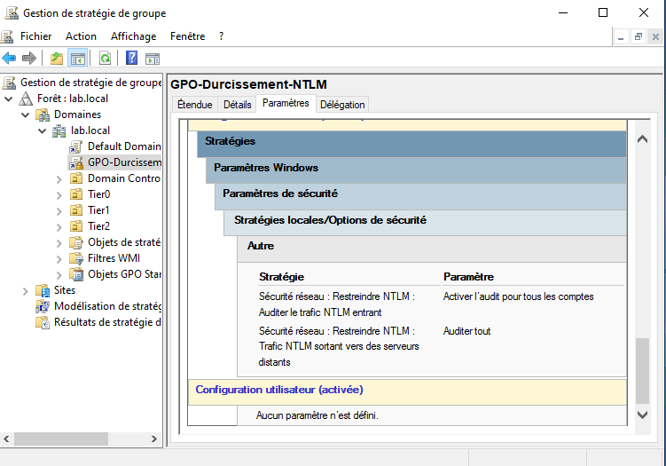
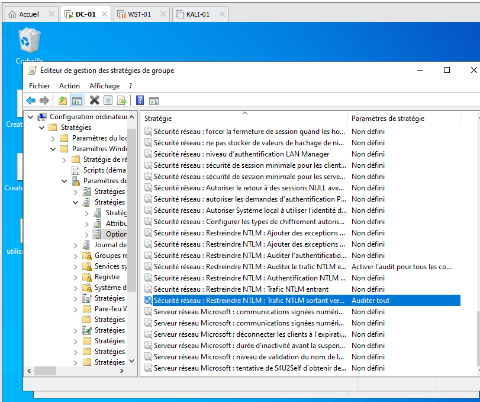

### Etape 2 - application et verification (`gpupdate` / RSOP)

Apres liaison de la GPO a la racine du domaine, `gpupdate /force` a ete lance sur DC-01 et sur WST-01.

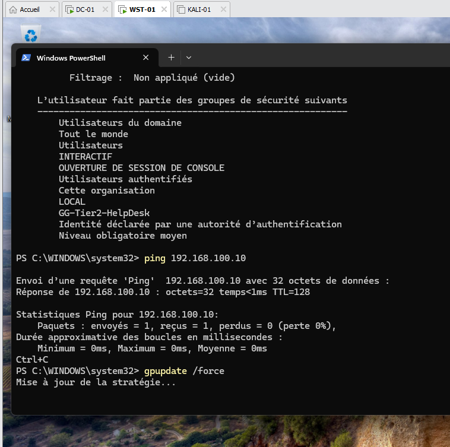

**Verification RSOP sur DC-01 (scope ordinateur)** : confirme que `GPO-Durcissement-NTLM` fait bien partie des "Objets Strategie de groupe appliques", aux cotes de `Default Domain Controllers Policy` et `Default Domain Policy`.

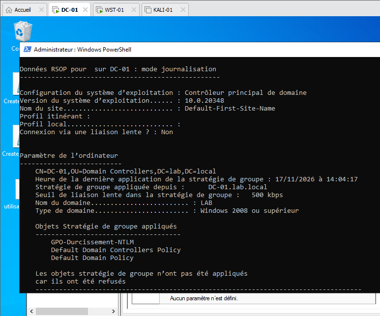

**Point de confusion rencontre et explique : `gpresult /r` sur WST-01 affichait `N/A`.** Ce n'etait pas un echec d'application - c'est le resultat **normal** du scope **Utilisateur** (celui par defaut de `gpresult /r`) : notre GPO ne contient que des reglages de **Configuration ordinateur**, donc le scope utilisateur n'a logiquement rien a afficher.

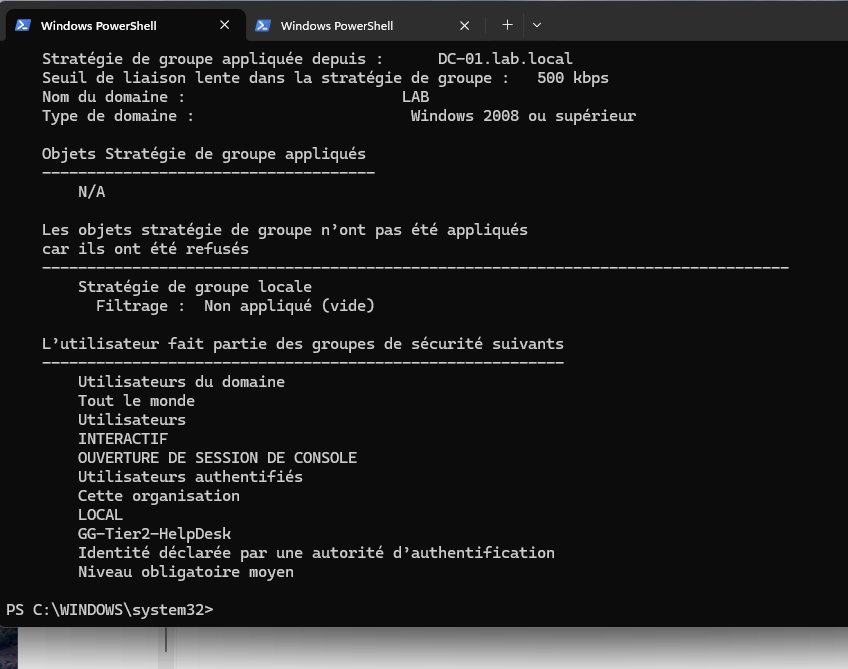

Pour voir le bon scope, il fallait `gpresult /r /scope:computer`, qui a d'abord renvoye "Acces refuse". La aussi, c'est voulu : **le scope ordinateur de RSOP exige des droits d'administrateur local**, car il expose via WMI (`root\rsop`) toute la configuration de securite de la machine - une information sensible du point de vue reconnaissance, protegee par Windows par defaut (meme logique de moindre privilege que le modele de tiering du projet). La commande a ete relancee depuis une session PowerShell elevee avec le compte **Administrateur local integre** de WST-01 - deliberement pas `adm-yelj` (compte Tier 0), pour ne pas faire toucher un identifiant Tier 0 a une machine Tier 2, conformement a la regle de tiering du projet.

### Etape 3 - passage en mode impose

Apres la periode d'audit (rapide ici, car lab isole sans systeme legacy), le reglage final a ete applique :

**Securite reseau : Niveau d'authentification LAN Manager** -> `Envoyer uniquement une reponse NTLMv2. Refuser LM et NTLM`

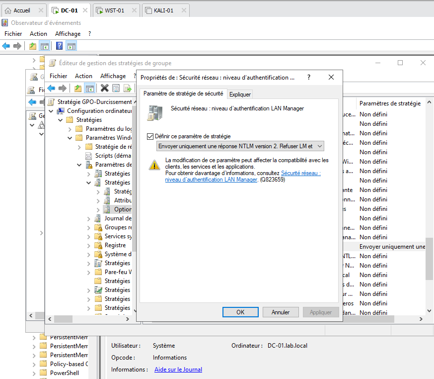

### Etape 4 - verification du resultat

Le rapport PingCastle re-scanne confirme deux choses :

1. **La GPO est bien vue et appliquee** - section "Security settings" du rapport, qui liste `GPO-Durcissement-NTLM` avec le reglage `LAN Manager authentication level = Send NTLMv2 response only. Refuse LM & NTLM`. Le reglage d'audit sortant (`Audit (Deny All is not enabled)`) apparait en rouge, ce qui est **attendu et volontaire** : il reste en mode audit pour l'instant, le blocage total (Deny All) du trafic NTLM sortant sera envisage plus tard, apres une periode d'observation plus longue.

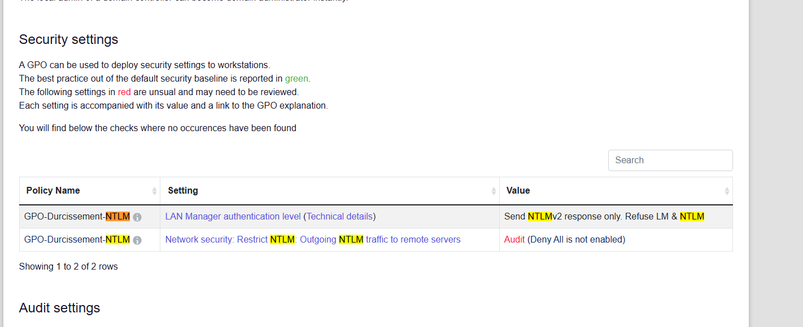

2. **`Stale Objects` est passe de 30/100 a 15/100** (-15 pts, exactement le poids de `S-OldNtlm`), confirmant que la regle est bien resolue. Il ne reste dans cette categorie que `S-AesNotEnabled` (10 pts) et `S-DC-SubnetMissing` (5 pts), les deux points encore ouverts et deliberement non traites pour l'instant (voir plus haut).

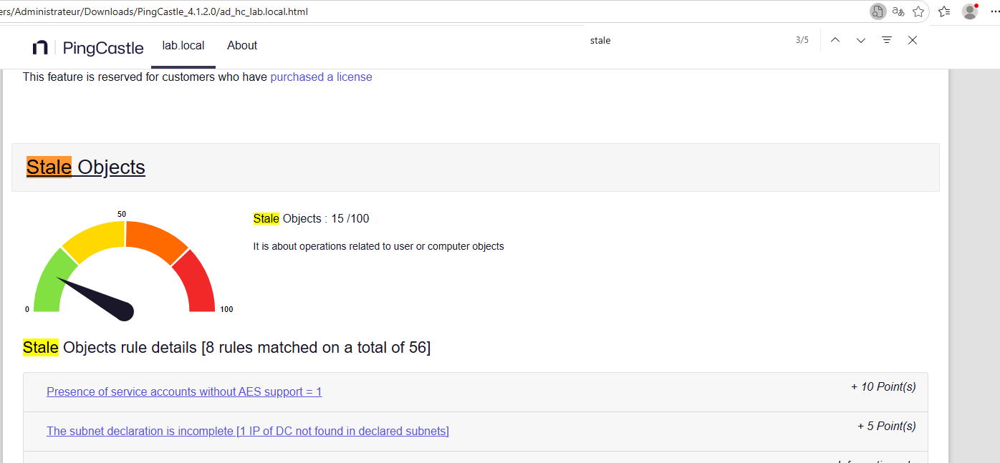

**Pourquoi le score global reste a 45/100 malgre une vraie correction.** Premiere reaction naturelle : "le score ne bouge pas, ca n'a pas marche". En realite si - mais le score de risque global du domaine est explicitement defini par PingCastle comme **le maximum des 4 categories, pas une moyenne ni une somme** (texte du rapport : *"It is the maximum score of the 4 indicators and one score cannot be higher than 100"*). Avant comme apres cette correction, `Anomalies` est reste a 45/100 (LAPS non deploye, audit DC, longueur de mot de passe, DC manquant, chemins UNC non durcis - voir plus haut) : c'est cette categorie qui fixe le plafond, independamment de l'ameliration reelle de `Stale Objects`. Autrement dit : la correction a bien fonctionne, mais elle ne devient visible sur le score global que lorsque `Stale Objects` cesse d'etre la pire categorie - ce qui n'etait deja plus le cas avant meme cette correction (`Anomalies` etait deja devant). Le prochain gain visible sur le score global viendra forcement d'une correction dans `Anomalies`.

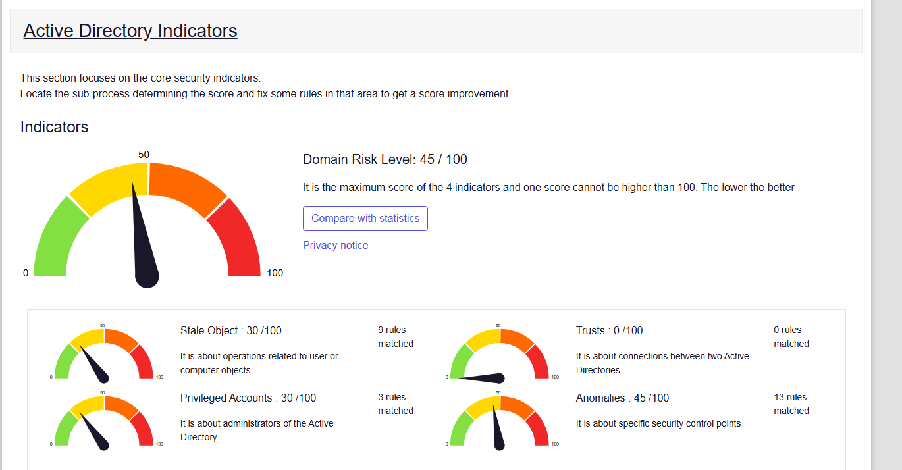

## Palier 3 - Deploiement de Windows LAPS (2026-11-20)

**Objectif.** Corriger `A-LAPS-Not-Installed` (15 pts, categorie Anomalies - celle qui plafonnait le score global depuis le palier 2).

### Le probleme que LAPS resout

Sur beaucoup de parcs AD, le compte **Administrateur local** de chaque poste/serveur partage **le meme mot de passe partout** (image master clonee, script de provisioning identique). Consequence directe : un attaquant qui recupere ce hash sur **une seule machine** (par exemple via Mimikatz apres une compromission initiale) peut rejouer ce meme hash (attaque **Pass-the-Hash**) pour se deplacer lateralement sur **tout le parc**, sans jamais avoir besoin du mot de passe en clair. C'est l'un des chemins de mouvement lateral les plus simples et les plus repandus en environnement AD.

**Ce que fait LAPS (Local Administrator Password Solution).** Chaque machine se voit attribuer un mot de passe admin local **unique, aleatoire, et change automatiquement** a intervalle regulier (30 jours ici). Le mot de passe est stocke chiffre directement sur l'objet ordinateur dans AD, lisible uniquement par les comptes explicitement autorises.

**Windows LAPS (version native).** Depuis Server 2022/Windows 11 (retroportee sur les versions anterieures via mises a jour), LAPS est integre nativement a l'OS et au schema AD, avec chiffrement de l'attribut cote AD (`msLAPS-EncryptedPassword`) - contrairement a l'ancienne version (Microsoft LAPS, un addon separe) qui stockait le mot de passe en clair dans un attribut, un risque si les permissions de lecture etaient mal configurees.

### Etape 1 - extension du schema AD

Premiere tentative bloquee : le module `LAPS` n'etait pas present sur DC-01 (`Update-LapsADSchema` renvoyait `CommandNotFoundException`). Diagnostic : DC-01 tournait en build RTM de Server 2022 (20348), jamais mis a jour depuis l'installation - **les cmdlets LAPS natives n'ont ete integrees a l'OS qu'a partir des cumulatifs d'avril 2023**. Windows Update a ete lance et le module est apparu apres redemarrage.

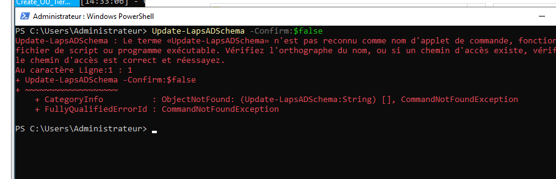

Deuxieme blocage, inattendu : une fois le module present, `Update-LapsADSchema` echouait avec *"L'utilisateur ne dispose pas de droits d'acces suffisants"*. Pas un bug - la **consequence directe du palier 1** : le groupe `Schema Admins` avait ete deliberement vide (`P-SchemaAdmin`) pour reduire la surface d'attaque, et modifier le schema AD exige d'en etre membre.

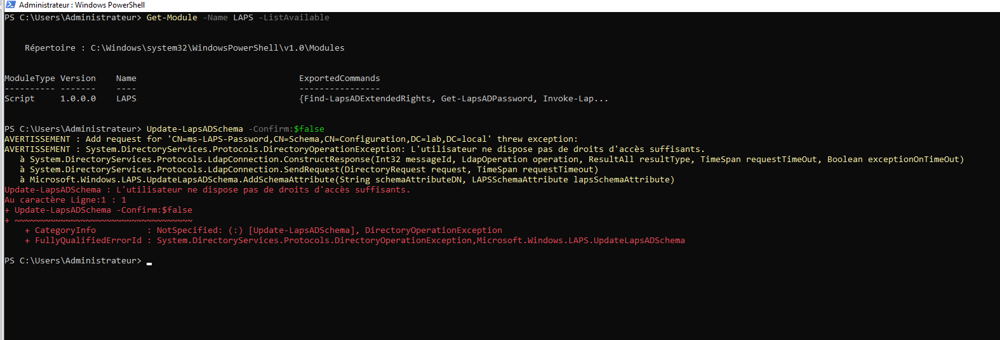

**Solution appliquee - le bon reflexe sur un groupe Schema Admins vide par defaut** : reintegrer temporairement le compte via le RID (`$sid = (Get-ADDomain).DomainSID.Value + "-518"`), faire l'operation, puis retirer immediatement le compte. Une premiere tentative a encore echoue juste apres l'ajout : le **ticket Kerberos de la session en cours avait ete emis avant l'ajout au groupe**, il ne refletait donc pas encore la nouvelle appartenance.

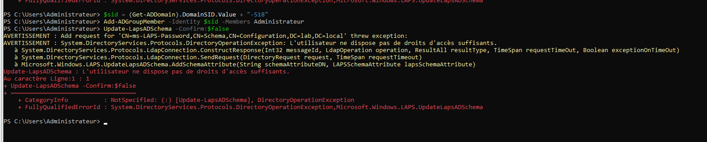

Une **nouvelle session** (donc un nouveau ticket Kerberos, a jour) a resolu le probleme : l'extension du schema est passee, puis le compte a ete immediatement retire de Schema Admins pour revenir a un groupe vide.

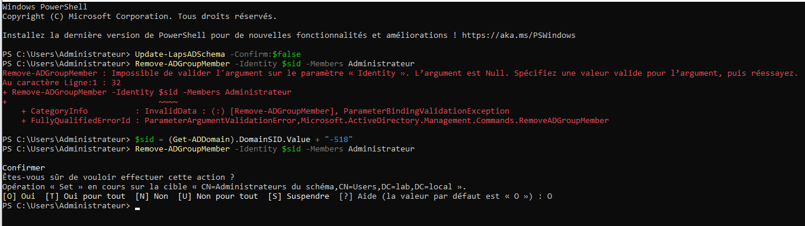

### Etape 2 - permissions LAPS sur l'OU cible

Deux permissions distinctes accordees sur `OU=Postes,OU=Tier2` :
- **Self-permission** (`Set-LapsADComputerSelfPermission`) : chaque machine a le droit d'ecrire son propre mot de passe LAPS sur son objet AD - c'est la machine elle-meme qui genere et pousse la rotation.
- **Read-permission** (`Set-LapsADReadPasswordPermission`) : le groupe de delegation deja existant `GG-Tier2-HelpDesk` a le droit de **lire** ce mot de passe quand besoin.

Premiere tentative avec le nom isole du groupe (`"GG-Tier2-HelpDesk"`) rejetee - la cmdlet exige un nom pleinement qualifie :

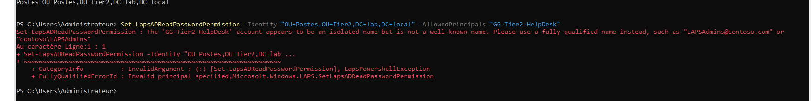

Corrige avec le format `DOMAINE\groupe` (`"LAB\GG-Tier2-HelpDesk"`) :

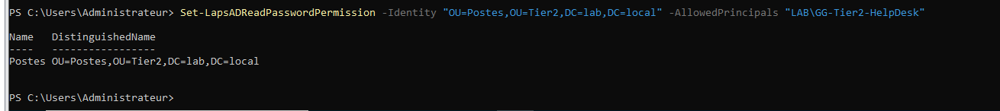

### Etape 3 - GPO dediee

Meme principe que pour la GPO NTLM (palier 2) : une GPO dediee `GPO-LAPS`, liee a `OU=Postes,OU=Tier2`, plutot que de toucher aux GPO par defaut. Parametres configures dans `Configuration ordinateur > Strategies > Modeles d'administration > System > LAPS` :

- **Configurer le repertoire de sauvegarde du mot de passe** -> `Active Directory`
- **Parametres du mot de passe** -> longueur 14, complexite elevee, age max 30 jours
- **Nom du compte administrateur a gerer** -> laisse **Non configure** (point de vigilance : il etait initialement passe par erreur sur `Active`, ce qui aurait fait chercher a LAPS un compte au nom specifique au lieu de gerer automatiquement, par SID, le compte `Administrateur` integre - corrige avant application)

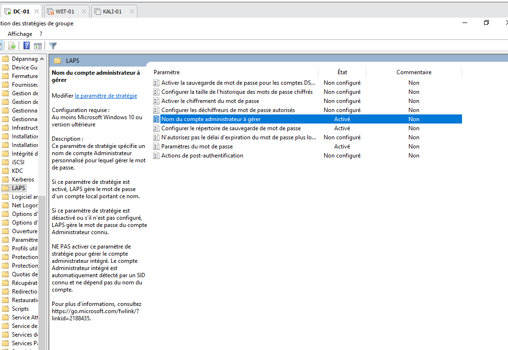

### Etape 4 - verification et piege du mauvais `gpupdate`

Premiere verification vide : `Get-LapsADPassword -Identity WST-01 -AsPlainText` ne renvoyait rien. Cause identifiee : le `gpupdate /force` initial avait ete lance sur **DC-01** au lieu de **WST-01** - DC-01 n'etant pas dans l'OU ciblee par `GPO-LAPS`, rien n'y a ete applique, donc rien a observer cote WST-01 non plus.

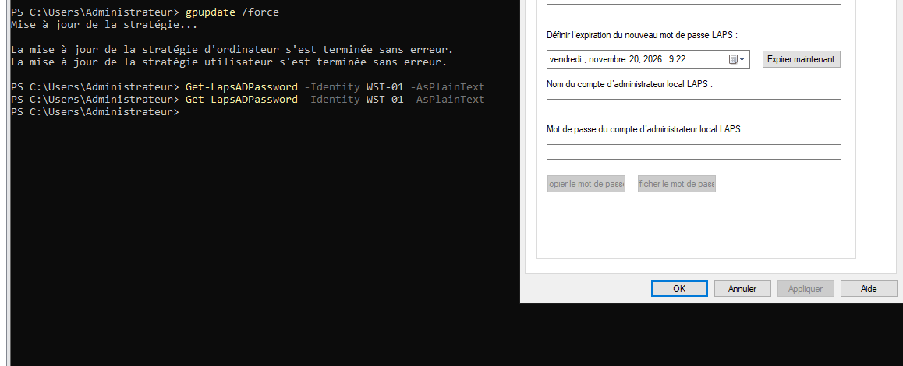

Une fois `gpupdate /force` relance **sur WST-01 lui-meme**, la rotation s'est declenchee immediatement :

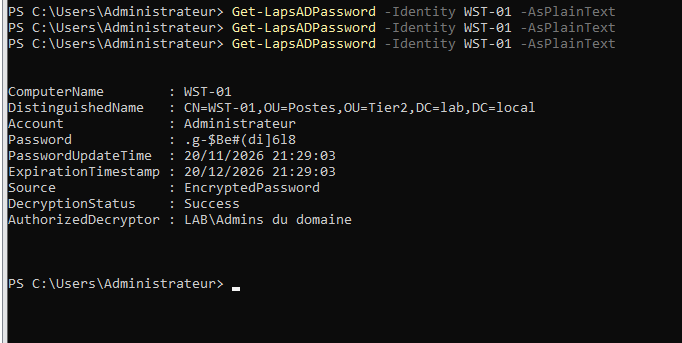

Champs cles du resultat : `PasswordUpdateTime` confirme que le mot de passe vient d'etre genere a l'instant, `ExpirationTimestamp` fixe la prochaine rotation a 30 jours, `DecryptionStatus: Success` confirme que le compte utilise a bien les droits de dechiffrement, et `AuthorizedDecryptor` liste `LAB\Admins du domaine` comme autorise.

**Consequence pratique immediate** : le mot de passe local `Administrateur` de WST-01 connu jusque-la n'est **plus valide** - LAPS l'a deja remplace. Toute connexion future en Administrateur local sur WST-01 necessite de repasser par `Get-LapsADPassword` (ou l'outil graphique equivalent) pour recuperer la valeur courante, qui elle-meme change automatiquement tous les 30 jours.

### Resultat PingCastle

Le re-scan confirme `A-LAPS-Not-Installed` corrige : `Anomalies` passe de 45/100 (13 regles) a **30/100** (12 regles), soit -15 pts - exactement le poids de la regle. Comme `Anomalies` etait la categorie qui plafonnait le score global depuis le palier 2, c'est **le premier vrai mouvement visible sur le score global** : 45 -> **30/100**.

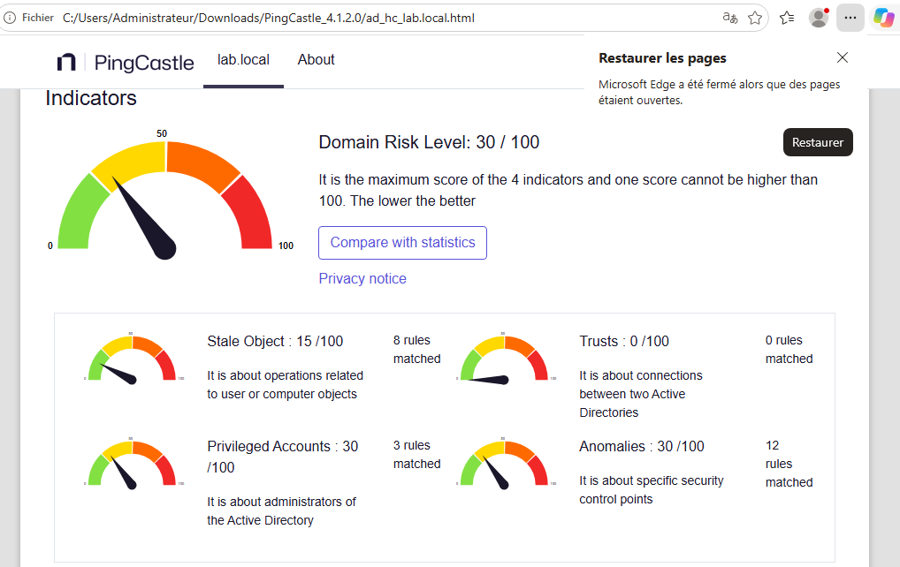

`Privileged Accounts` (30/100) et `Anomalies` (30/100) sont desormais a egalite comme prochain goulot d'etranglement pour continuer a faire baisser le score global.

## Glossaire - NTLM, Kerberos et les attaques qui en decoulent

Plusieurs regles de ce rapport (`S-OldNtlm`, `S-AesNotEnabled`) touchent directement aux protocoles d'authentification AD. Pour comprendre *pourquoi* elles comptent, il faut distinguer NTLM et Kerberos.

**NTLM** - protocole d'authentification par defi/reponse (challenge-response), sans tiers de confiance ni ticket : le serveur envoie un defi aleatoire, le client repond en chiffrant ce defi avec le hash de son mot de passe. NTLMv1 est cryptographiquement cassable et NTLMv2, bien que plus solide, reste plus faible que Kerberos - d'ou la regle `S-OldNtlm` qui verifie qu'une GPO interdit bien NTLMv1/LM.

**Kerberos** - protocole par defaut dans AD, base sur des tickets delivres par le KDC (le controleur de domaine) :
1. Le client s'authentifie une seule fois aupres du KDC et reçoit un **TGT** (Ticket Granting Ticket), chiffre avec le hash du compte `krbtgt`.
2. Pour chaque service vise, le client presente son TGT au KDC et reçoit en retour un **TGS** (ticket de service), chiffre cette fois avec le hash du compte associe a ce service precis.
3. Le client presente directement ce TGS au service, qui le dechiffre lui-meme - sans jamais recontacter le KDC.

**Attaque par relais NTLM (NTLM relay).** Un attaquant positionne entre le client et le serveur (souvent via un empoisonnement LLMNR/NBT-NS) ne casse pas le hash : il **relaie en direct**, en temps reel, le defi/reponse NTLM capture vers une autre machine, se faisant passer pour le client authentifie. Possible parce que NTLM n'attache pas cryptographiquement de destination a sa reponse, contrairement a un ticket Kerberos.

**Kerberoasting.** Exploite l'etape 2 ci-dessus : n'importe quel compte authentifie du domaine peut legitimement demander un TGS pour n'importe quel service possedant un SPN. L'attaquant recupere ainsi des TGS pour tous les comptes de service trouves, puis tente de **casser hors ligne** le chiffrement du ticket (= casser le mot de passe du compte de service). Aucun privilege requis pour lancer l'attaque elle-meme.

**Golden Ticket.** Si l'attaquant vole le hash du compte `krbtgt` (celui qui chiffre tous les TGT du domaine), il peut forger un TGT valide pour n'importe quel utilisateur avec n'importe quels droits, sans authentification reelle. C'est pour cette raison qu'une remediation apres compromission avancee exige de reinitialiser le mot de passe `krbtgt` **deux fois**.

**Silver Ticket.** Variante plus ciblee : forger directement un TGS (pas un TGT) avec le hash d'**un seul** compte de service - plus discret (aucun contact avec le KDC lors de la forge) mais limite a ce service precis.

**Lien avec ce module.** L'AES qu'on vient d'activer sur les comptes privilegies rend leurs tickets Kerberos resistants a un cassage hors ligne type Kerberoasting (AES >> RC4 en robustesse). `S-OldNtlm`, encore a corriger, concerne directement l'exposition au relais NTLM. Kerberoasting, AS-REP Roasting, et la fabrication de Golden/Silver Ticket restent des demonstrations pratiques prevues dans [03-attaque-ad](../../03-attaque-ad/README.md).
