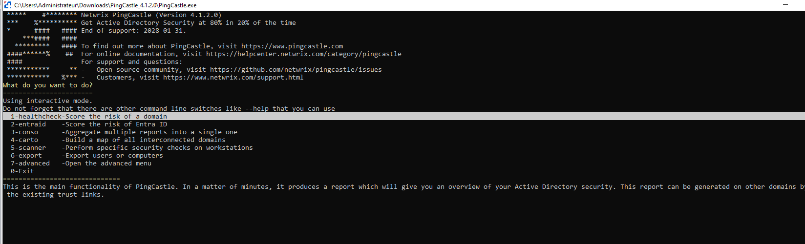
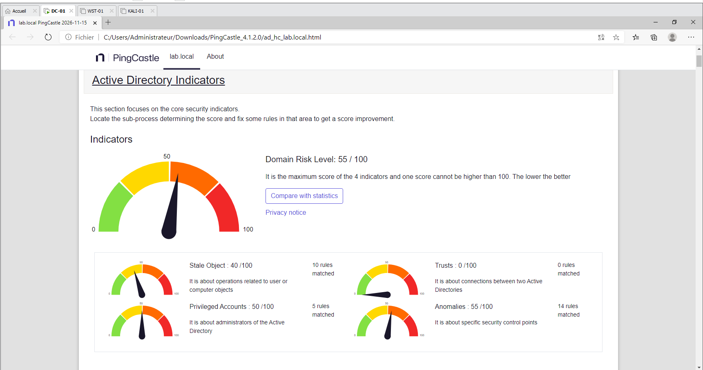

# Audit PingCastle - baseline et plan de remediation

[Retour a l'index 01-ad-core](../README.md)

## Quoi et pourquoi

[PingCastle](https://www.pingcastle.com/) est l'outil de reference pour auditer la securite d'un Active Directory. Il analyse le domaine et produit un score de risque par categorie (0 = parfait, plus c'est haut, pire c'est), avec un rapport detaille et des recommandations pour chaque point souleve. L'interet pour ce lab : avoir une note chiffree et traçable, pour documenter une vraie progression (comme on l'a deja fait a petite echelle avec `lockoutThreshold`), plutot qu'une simple liste de bonnes intentions.

## Comment (execution)

Sur DC-01, version gratuite telechargee depuis [pingcastle.com](https://www.pingcastle.com/download/) (via la carte NAT), executee sans installation :

```powershell
.\PingCastle.exe --healthcheck --server lab.local
```




Rapport complet (HTML, interactif) : [pingcastle/rapport-pingcastle-2026-11-15.html](../pingcastle/rapport-pingcastle-2026-11-15.html)

## Resultat - baseline du 2026-11-15

**Score de risque global : 55 / 100** (le score du domaine est le maximum des 4 categories, pas une moyenne - une seule categorie mauvaise suffit a plomber la note globale)



| Categorie | Score | Regles matchees | Ce que ca couvre |
|---|---|---|---|
| Stale Objects | 40/100 | 10 / 56 | Operations liees aux objets utilisateur/ordinateur |
| Privileged Accounts | 50/100 | 5 / 48 | Administrateurs de l'annuaire |
| Trusts | 0/100 | 0 / 12 | Relations avec d'autres domaines (non applicable, un seul domaine) |
| Anomalies | 55/100 | 14 / 77 | Points de controle de securite specifiques |


## Detail des regles qui comptent des points (les 0-point/informatives ne sont pas listees ici, elles sont dans le rapport complet)

### Stale Objects (40 pts)

| Regle | Points | Constat |
|---|---|---|
| S-OldNtlm | 15 | NTLMv1/LM acceptes par les DC (pas de GPO definissant le niveau d'authentification LAN Manager) |
| S-AesNotEnabled | 10 | Le compte `Administrateur` n'a pas AES active pour Kerberos (reste sur RC4) |
| S-ADRegistration | 10 | Tout utilisateur standard peut ajouter jusqu'a 10 ordinateurs au domaine (`ms-DS-MachineAccountQuota` par defaut) |
| S-DC-SubnetMissing | 5 | Le sous-reseau 192.168.100.0/24 n'est pas declare dans AD Sites and Services |

### Privileged Accounts (50 pts)

| Regle | Points | Constat |
|---|---|---|
| P-Delegated | 20 | `Administrateur` et `adm-yelj` n'ont pas le flag "compte sensible, ne peut pas etre delegue" |
| P-ProtectedUsers | 10 | Aucun des deux comptes admin n'est dans le groupe `Protected Users` |
| P-SchemaAdmin | 10 | Le groupe `Schema Admins` n'est pas vide (1 compte, probablement `Administrateur` par defaut) |
| P-RecycleBin | 10 | La corbeille AD (Recycle Bin) n'est pas activee |

### Anomalies (55 pts)

| Regle | Points | Constat |
|---|---|---|
| A-LAPS-Not-Installed | 15 | LAPS non deploye (deja identifie plus tot dans le projet) |
| A-AuditDC | 10 | La politique d'audit attendue sur les DC n'est pas en place |
| A-DC-Spooler | 10 | Le service Spooler (impression) tourne sur le DC - exploitable (PrintNightmare) |
| A-MinPwdLen | 10 | Longueur minimale de mot de passe trop faible (7, deja repere pendant l'attaque LDAP du module 03) |
| A-NotEnoughDC | 5 | Un seul DC - pas de redondance (DC-02 deja prevu) |
| A-HardenedPaths | 5 | Pas de durcissement des chemins UNC (SYSVOL/NETLOGON) |

## Plan de remediation, par ordre de priorite

Priorite donnee aux correctifs rapides et a faible risque d'abord (une commande, pas d'impact fonctionnel attendu), puis aux correctifs qui demandent plus de prudence ou une GPO.

### A faire en premier (gains rapides, faible risque)

1. **P-RecycleBin** - `Enable-ADOptionalFeature -Identity 'Recycle Bin Feature' -Scope ForestOrConfigurationSet -Target lab.local`
2. **S-ADRegistration** - `Set-ADDomain -Identity lab.local -Replace @{"ms-DS-MachineAccountQuota"=0}`
3. **P-SchemaAdmin** - verifier puis retirer le membre par defaut : `Get-ADGroupMember "Schema Admins"` puis `Remove-ADGroupMember "Schema Admins" -Members <compte>`
4. **S-AesNotEnabled** - `Set-ADUser -Identity Administrateur -Replace @{"msDS-SupportedEncryptionTypes"=24}`
5. **A-DC-Spooler** - `Stop-Service -Name Spooler -Force; Set-Service -Name Spooler -StartupType Disabled`
6. **S-DC-SubnetMissing** - `New-ADReplicationSubnet -Name "192.168.100.0/24" -Site "Default-First-Site-Name"`

### A faire ensuite (impact fonctionnel a verifier avant d'appliquer)

7. **A-MinPwdLen** - remonter `MinPasswordLength` (ex: 14) via `Set-ADDefaultDomainPasswordPolicy`
8. **P-Delegated + P-ProtectedUsers** (30 pts cumules) - ajouter `adm-yelj` (et prudemment `Administrateur`) au groupe `Protected Users` - attention, ce groupe force Kerberos pur (plus de NTLM, plus de cache d'identifiants, plus de delegation) : a tester d'abord sur `adm-yelj` seul pour ne pas se retrouver bloque
9. **S-OldNtlm** - GPO "Network security: LAN Manager authentication level" -> "Send NTLMv2 response only. Refuse LM & NTLM"
10. **A-HardenedPaths** - GPO durcissement des chemins UNC SYSVOL/NETLOGON

### Deja planifie ailleurs dans le projet

- **A-LAPS-Not-Installed** - sera traite dans la phase GPO de durcissement (deploiement complet de Windows LAPS)
- **A-NotEnoughDC** - sera resolu par le provisioning de DC-02

## Suivi de la progression

| Date | Score global | Stale | Privileged | Trusts | Anomalies | Notes |
|---|---|---|---|---|---|---|
| 2026-11-15 | 55/100 | 40/100 | 50/100 | 0/100 | 55/100 | Baseline, avant tout correctif |
