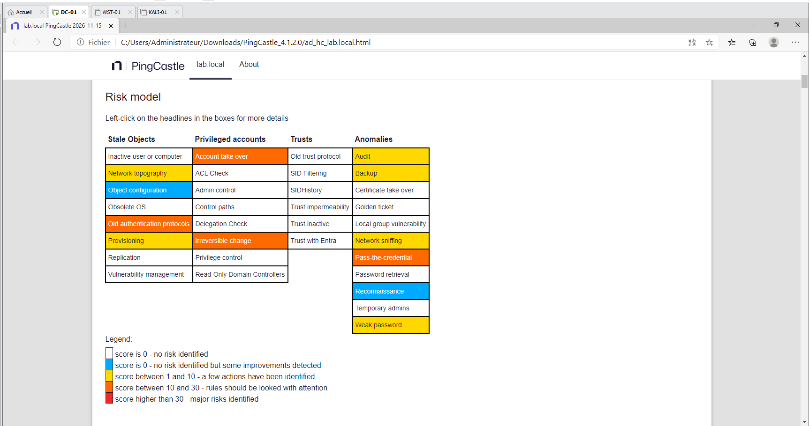
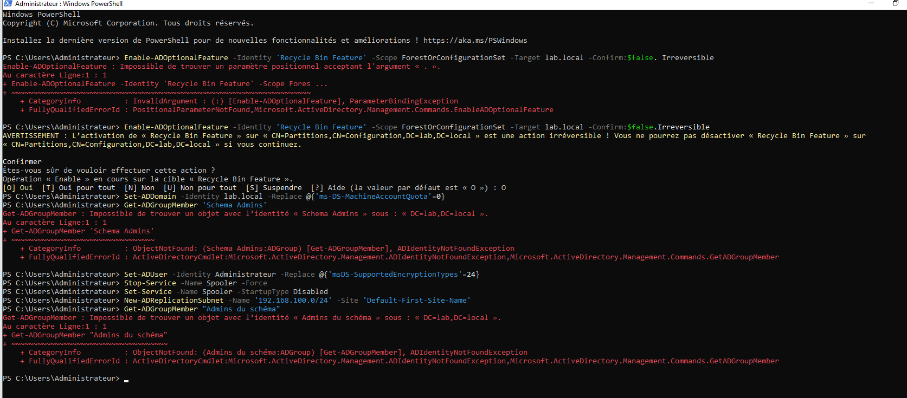
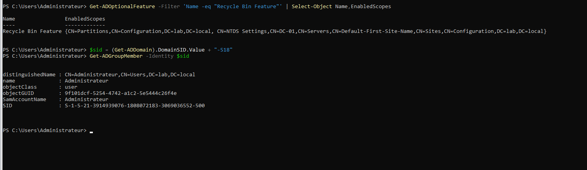

# Audit PingCastle - baseline et plan de remediation

[Retour a l'index 01-ad-core](../README.md)

## Quoi et pourquoi

[PingCastle](https://www.pingcastle.com/) est l'outil de reference pour auditer la securite d'un Active Directory. Il analyse le domaine et produit un score de risque par categorie (0 = parfait, plus c'est haut, pire c'est), avec un rapport detaille et des recommandations pour chaque point souleve. L'interet pour ce lab : avoir une note chiffree et traçable, pour documenter une vraie progression (comme on l'a deja fait a petite echelle avec `lockoutThreshold`), plutot qu'une simple liste de bonnes intentions.

## Comment (execution)

Sur DC-01, version gratuite telechargee depuis [pingcastle.com](https://www.pingcastle.com/download/) (via la carte NAT), executee sans installation :

```powershell
.\PingCastle.exe --healthcheck --server lab.local
```


Rapport complet (HTML, interactif) : [pingcastle/rapport-pingcastle-2026-11-15.html](../pingcastle/rapport-pingcastle-2026-11-15.html)

## Resultat - baseline du 2026-11-15

**Score de risque global : 55 / 100** (le score du domaine est le maximum des 4 categories, pas une moyenne - une seule categorie mauvaise suffit a plomber la note globale)


| Categorie | Score | Regles matchees | Ce que ca couvre |
|---|---|---|---|
| Stale Objects | 40/100 | 10 / 56 | Operations liees aux objets utilisateur/ordinateur |
| Privileged Accounts | 50/100 | 5 / 48 | Administrateurs de l'annuaire |
| Trusts | 0/100 | 0 / 12 | Relations avec d'autres domaines (non applicable, un seul domaine) |
| Anomalies | 55/100 | 14 / 77 | Points de controle de securite specifiques |



## Detail des regles qui comptent des points (les 0-point/informatives ne sont pas listees ici, elles sont dans le rapport complet)

### Stale Objects (40 pts)

| Regle | Points | Constat |
|---|---|---|
| S-OldNtlm | 15 | NTLMv1/LM acceptes par les DC (pas de GPO definissant le niveau d'authentification LAN Manager) |
| S-AesNotEnabled | 10 | Le compte `Administrateur` n'a pas AES active pour Kerberos (reste sur RC4) |
| S-ADRegistration | 10 | Tout utilisateur standard peut ajouter jusqu'a 10 ordinateurs au domaine (`ms-DS-MachineAccountQuota` par defaut) |
| S-DC-SubnetMissing | 5 | Le sous-reseau 192.168.100.0/24 n'est pas declare dans AD Sites and Services |

### Privileged Accounts (50 pts)

| Regle | Points | Constat |
|---|---|---|
| P-Delegated | 20 | `Administrateur` et `adm-yelj` n'ont pas le flag "compte sensible, ne peut pas etre delegue" |
| P-ProtectedUsers | 10 | Aucun des deux comptes admin n'est dans le groupe `Protected Users` |
| P-SchemaAdmin | 10 | Le groupe `Schema Admins` n'est pas vide (1 compte, probablement `Administrateur` par defaut) |
| P-RecycleBin | 10 | La corbeille AD (Recycle Bin) n'est pas activee |

### Anomalies (55 pts)

| Regle | Points | Constat |
|---|---|---|
| A-LAPS-Not-Installed | 15 | LAPS non deploye (deja identifie plus tot dans le projet) |
| A-AuditDC | 10 | La politique d'audit attendue sur les DC n'est pas en place |
| A-DC-Spooler | 10 | Le service Spooler (impression) tourne sur le DC - exploitable (PrintNightmare) |
| A-MinPwdLen | 10 | Longueur minimale de mot de passe trop faible (7, deja repere pendant l'attaque LDAP du module 03) |
| A-NotEnoughDC | 5 | Un seul DC - pas de redondance (DC-02 deja prevu) |
| A-HardenedPaths | 5 | Pas de durcissement des chemins UNC (SYSVOL/NETLOGON) |

## Plan de remediation, par ordre de priorite

Priorite donnee aux correctifs rapides et a faible risque d'abord (une commande, pas d'impact fonctionnel attendu), puis aux correctifs qui demandent plus de prudence ou une GPO.

### A faire en premier (gains rapides, faible risque) - FAIT le 2026-11-17

1. [x] **P-RecycleBin** - `Enable-ADOptionalFeature -Identity 'Recycle Bin Feature' -Scope ForestOrConfigurationSet -Target lab.local` - corrige, confirme par le re-scan
2. [x] **S-ADRegistration** - `Set-ADDomain -Identity lab.local -Replace @{"ms-DS-MachineAccountQuota"=0}` - corrige, confirme par le re-scan
3. [x] **P-SchemaAdmin** - retrait via le RID (518) plutot que le nom (voir section resultat detaille) - corrige, confirme par le re-scan
4. [ ] **S-AesNotEnabled** - fait sur `Administrateur`, **pas encore sur `adm-yelj`** - regle toujours active, a corriger
5. [x] **A-DC-Spooler** - `Stop-Service -Name Spooler -Force; Set-Service -Name Spooler -StartupType Disabled` - corrige, confirme par le re-scan
6. [ ] **S-DC-SubnetMissing** - un sous-reseau declare, **mais DC-01 a 2 IP** - a verifier/completer

### A faire ensuite (impact fonctionnel a verifier avant d'appliquer)

7. **A-MinPwdLen** - remonter `MinPasswordLength` (ex: 14) via `Set-ADDefaultDomainPasswordPolicy`
8. **P-Delegated + P-ProtectedUsers** (30 pts cumules) - ajouter `adm-yelj` (et prudemment `Administrateur`) au groupe `Protected Users` - attention, ce groupe force Kerberos pur (plus de NTLM, plus de cache d'identifiants, plus de delegation) : a tester d'abord sur `adm-yelj` seul pour ne pas se retrouver bloque
9. **S-OldNtlm** - GPO "Network security: LAN Manager authentication level" -> "Send NTLMv2 response only. Refuse LM & NTLM"
10. **A-HardenedPaths** - GPO durcissement des chemins UNC SYSVOL/NETLOGON

### Deja planifie ailleurs dans le projet

- **A-LAPS-Not-Installed** - sera traite dans la phase GPO de durcissement (deploiement complet de Windows LAPS)
- **A-NotEnoughDC** - sera resolu par le provisioning de DC-02

## Suivi de la progression

| Date | Score global | Stale | Privileged | Trusts | Anomalies | Notes |
|---|---|---|---|---|---|---|
| 2026-11-15 | 55/100 | 40/100 | 50/100 | 0/100 | 55/100 | Baseline, avant tout correctif |
| 2026-11-17 | 45/100 | 30/100 | 30/100 | 0/100 | 45/100 | Apres le palier 1 (6 corrections rapides) |


## Palier 1 - resultat detaille (2026-11-17)

Les 6 corrections ont ete executees sur DC-01, en PowerShell eleve (session Administrateur) :



| # | Correctif | Commande | Resultat |
|---|---|---|---|
| 1 | Corbeille AD activee | `Enable-ADOptionalFeature 'Recycle Bin Feature' ...` | OK - confirme par `EnabledScopes` non vide |
| 2 | Quota machine a 0 | `Set-ADDomain ... ms-DS-MachineAccountQuota=0` | OK |
| 3 | Schema Admins vide | `Remove-ADGroupMember` (via le RID, voir plus bas) | OK - groupe vide, verifie |
| 4 | AES sur Administrateur | `Set-ADUser Administrateur ... msDS-SupportedEncryptionTypes=24` | Execute, mais **le score ne bouge pas encore** (voir note) |
| 5 | Spooler desactive sur le DC | `Stop-Service` + `Set-Service -StartupType Disabled` | OK |
| 6 | Sous-reseau declare | `New-ADReplicationSubnet` | Execute, mais **le score ne bouge pas encore** (voir note) |




**Petit aparte linguistique.** Le nom reel du groupe en francais n'est ni `Schema Admins` ni l'hypothese initiale `Admins du schema` - c'est **`Administrateurs du schema`**. Les deux premieres tentatives ont echoue (`ObjectNotFoundException`), pas a cause d'un probleme d'accent comme soupçonne au depart, mais a cause d'une mauvaise traduction. Solution retenue : utiliser le RID (518, independant de toute langue) plutot que de deviner le bon nom :

```powershell
$sid = (Get-ADDomain).DomainSID.Value + "-518"
Get-ADGroupMember -Identity $sid
Remove-ADGroupMember -Identity $sid -Members Administrateur
```

**Score : 55 -> 45/100.** Le detail par categorie confirme precisement quelles regles ont ete levees :

| Categorie | Avant | Apres | Regles matchees avant/apres | Explication |
|---|---|---|---|---|
| Stale Objects | 40 | 30 | 10 -> 9 | -10 pts = `S-ADRegistration` corrige. `S-AesNotEnabled` (10 pts) et `S-DC-SubnetMissing` (5 pts) sont toujours actives malgre les commandes executees (voir ci-dessous) |
| Privileged Accounts | 50 | 30 | 5 -> 3 | -20 pts = `P-RecycleBin` + `P-SchemaAdmin` corriges, les deux a 100% |
| Trusts | 0 | 0 | 0 -> 0 | Inchange, attendu (domaine unique) |
| Anomalies | 55 | 45 | 14 -> 13 | -10 pts = `A-DC-Spooler` corrige |

**Pourquoi AES et le sous-reseau n'ont pas encore fait bouger le score :**

- `S-AesNotEnabled` verifie vraisemblablement **tous les comptes privilegies**, pas seulement `Administrateur`. Comme `adm-yelj` est egalement membre de `Admins du domaine` et n'a pas encore AES active, la regle reste declenchee. A corriger : `Set-ADUser -Identity adm-yelj -Replace @{"msDS-SupportedEncryptionTypes"=24}`, puis re-verifier.
- `S-DC-SubnetMissing` mentionnait a l'origine **2 adresses IP pour DC-01** (probablement une carte isolee + une carte NAT pour l'acces Internet, utilisee par exemple pour telecharger PingCastle). Seul un sous-reseau a ete declare. A verifier : `ipconfig /all` sur DC-01 pour lister toutes ses IP, puis `Get-ADReplicationSubnet -Filter *` pour confirmer que chaque IP tombe bien dans un sous-reseau declare - declarer le sous-reseau manquant si besoin.

Ces deux points restent ouverts et seront verifies au prochain passage.

## Glossaire - NTLM, Kerberos et les attaques qui en decoulent

Plusieurs regles de ce rapport (`S-OldNtlm`, `S-AesNotEnabled`) touchent directement aux protocoles d'authentification AD. Pour comprendre *pourquoi* elles comptent, il faut distinguer NTLM et Kerberos.

**NTLM** - protocole d'authentification par defi/reponse (challenge-response), sans tiers de confiance ni ticket : le serveur envoie un defi aleatoire, le client repond en chiffrant ce defi avec le hash de son mot de passe. NTLMv1 est cryptographiquement cassable et NTLMv2, bien que plus solide, reste plus faible que Kerberos - d'ou la regle `S-OldNtlm` qui verifie qu'une GPO interdit bien NTLMv1/LM.

**Kerberos** - protocole par defaut dans AD, base sur des tickets delivres par le KDC (le controleur de domaine) :
1. Le client s'authentifie une seule fois aupres du KDC et reçoit un **TGT** (Ticket Granting Ticket), chiffre avec le hash du compte `krbtgt`.
2. Pour chaque service vise, le client presente son TGT au KDC et reçoit en retour un **TGS** (ticket de service), chiffre cette fois avec le hash du compte associe a ce service precis.
3. Le client presente directement ce TGS au service, qui le dechiffre lui-meme - sans jamais recontacter le KDC.

**Attaque par relais NTLM (NTLM relay).** Un attaquant positionne entre le client et le serveur (souvent via un empoisonnement LLMNR/NBT-NS) ne casse pas le hash : il **relaie en direct**, en temps reel, le defi/reponse NTLM capture vers une autre machine, se faisant passer pour le client authentifie. Possible parce que NTLM n'attache pas cryptographiquement de destination a sa reponse, contrairement a un ticket Kerberos.

**Kerberoasting.** Exploite l'etape 2 ci-dessus : n'importe quel compte authentifie du domaine peut legitimement demander un TGS pour n'importe quel service possedant un SPN. L'attaquant recupere ainsi des TGS pour tous les comptes de service trouves, puis tente de **casser hors ligne** le chiffrement du ticket (= casser le mot de passe du compte de service). Aucun privilege requis pour lancer l'attaque elle-meme.

**Golden Ticket.** Si l'attaquant vole le hash du compte `krbtgt` (celui qui chiffre tous les TGT du domaine), il peut forger un TGT valide pour n'importe quel utilisateur avec n'importe quels droits, sans authentification reelle. C'est pour cette raison qu'une remediation apres compromission avancee exige de reinitialiser le mot de passe `krbtgt` **deux fois**.

**Silver Ticket.** Variante plus ciblee : forger directement un TGS (pas un TGT) avec le hash d'**un seul** compte de service - plus discret (aucun contact avec le KDC lors de la forge) mais limite a ce service precis.

**Lien avec ce module.** L'AES qu'on vient d'activer sur les comptes privilegies rend leurs tickets Kerberos resistants a un cassage hors ligne type Kerberoasting (AES >> RC4 en robustesse). `S-OldNtlm`, encore a corriger, concerne directement l'exposition au relais NTLM. Kerberoasting, AS-REP Roasting, et la fabrication de Golden/Silver Ticket restent des demonstrations pratiques prevues dans [03-attaque-ad](../../03-attaque-ad/README.md).
