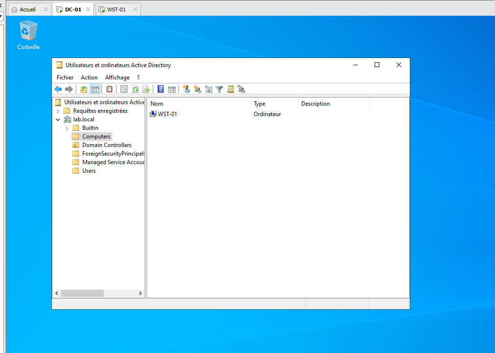

# 02 - Postes et tiering client

Statut : en cours (phase 2 du calendrier)

Ce module couvre le cycle de vie des postes clients : jonction au domaine, placement dans l'OU de tiering correspondante, et (a venir) GPO de durcissement poste. La construction de l'annuaire lui-meme (foret, OU, comptes) est documentee dans [01-ad-core](../01-ad-core/README.md).

## VM concernees

- **WST-01** : Windows 11 Pro, poste client de test, joint au domaine `lab.local`, range dans `OU=Postes,OU=Tier2`

## Etapes realisees

### Jonction de WST-01 au domaine

WST-01 n'heberge aucune zone DNS, contrairement a DC-01. Pour resoudre les enregistrements SRV de `lab.local` et trouver un controleur de domaine, son client DNS doit pointer vers DC-01 (pas vers lui-meme, pas vers la passerelle NAT) :

```powershell
# Sur WST-01
Set-DnsClientServerAddress -InterfaceAlias "Ethernet1" -ServerAddresses 192.168.100.10

# Verification avant de tenter le join
Resolve-DnsName lab.local
nslookup -type=srv _ldap._tcp.lab.local

# Jonction au domaine
Add-Computer -DomainName "lab.local" -Credential (Get-Credential) -Restart
```

Apres redemarrage, WST-01 apparait dans le conteneur `Computers` de `lab.local` via la console Utilisateurs et ordinateurs Active Directory sur DC-01.



### Placement dans l'OU de tiering

Un objet ordinateur fraichement joint atterrit par defaut dans le conteneur plat `Computers`, qui ne porte aucune information de tiering. Pour que WST-01 recoive les futures GPO de poste standard (Tier 2), il est deplace dans l'arborescence construite en [01-ad-core](../01-ad-core/README.md#arborescence-dou-et-modele-de-tiering-tier-012) :

```powershell
Get-ADComputer WST-01 | Move-ADObject -TargetPath "OU=Postes,OU=Tier2,DC=lab,DC=local"
```

## Etapes a venir

- GPO de poste standard appliquees sur `Tier2/Postes` (restrictions utilisateur, durcissement de base)
- Provisioning d'un deuxieme poste pour tester la coherence des GPO
- Tests de connexion avec les comptes utilisateurs crees en [01-ad-core](../01-ad-core/README.md#csv-et-creation-en-masse-des-utilisateurs)

## captures/

Captures des etapes ci-dessus.
