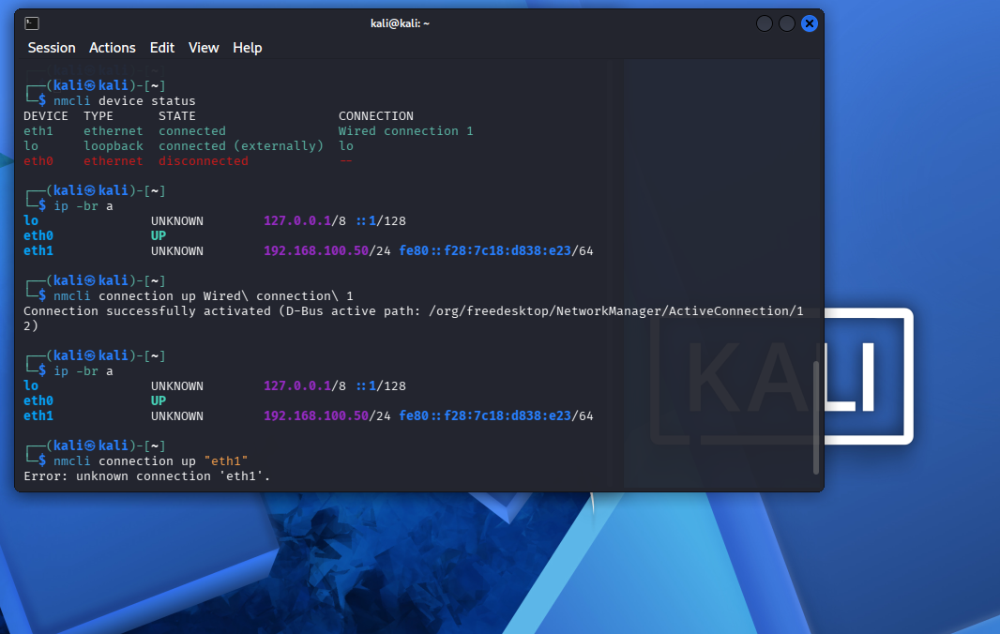
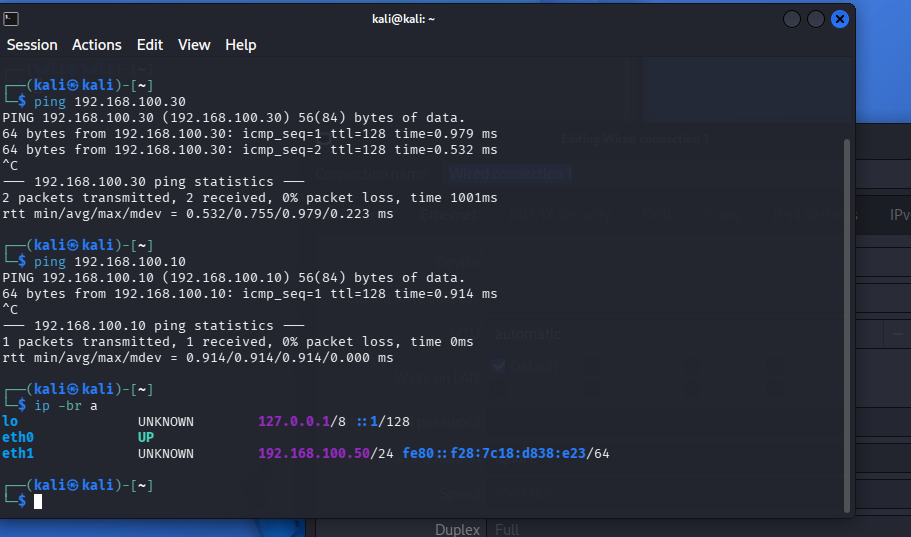
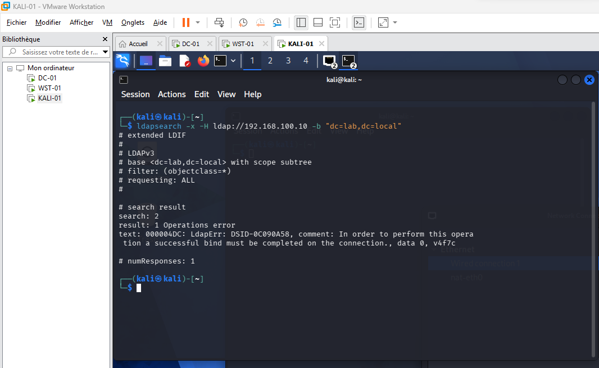
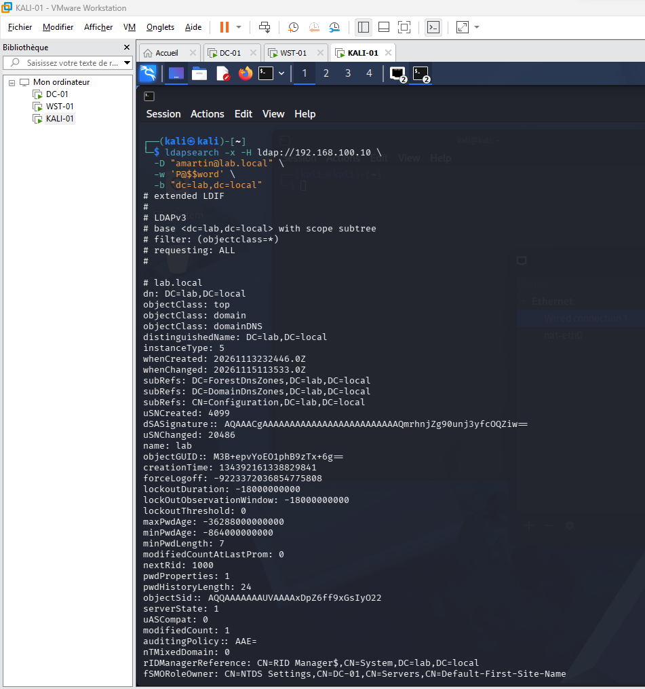
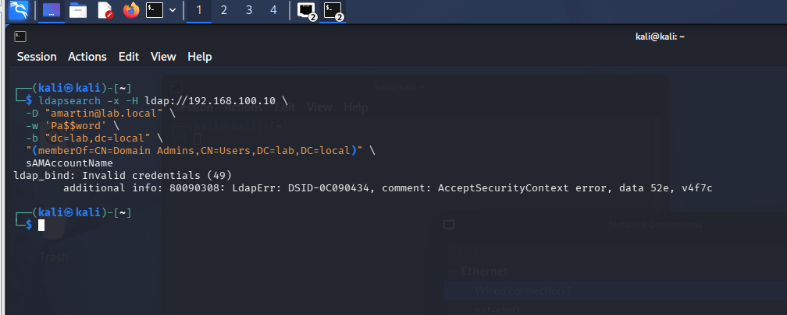
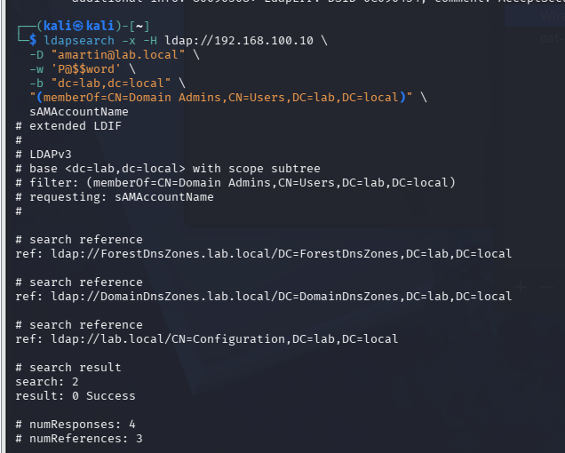
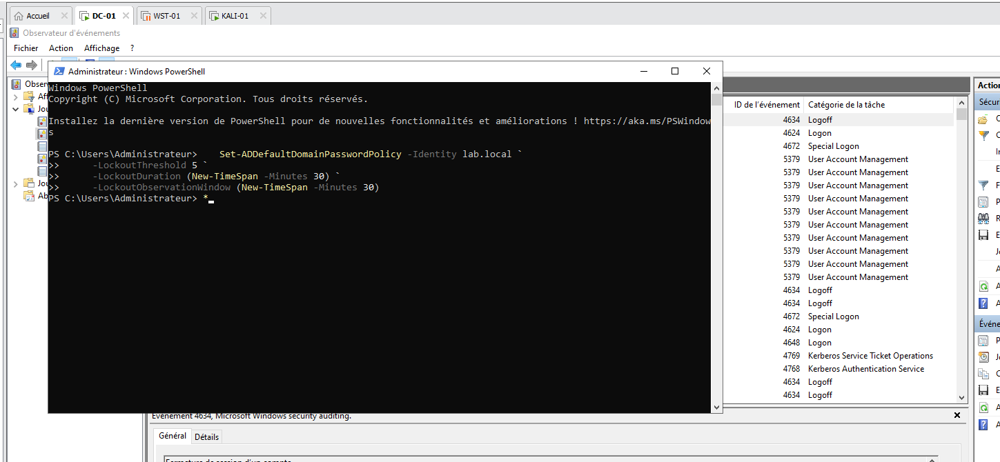
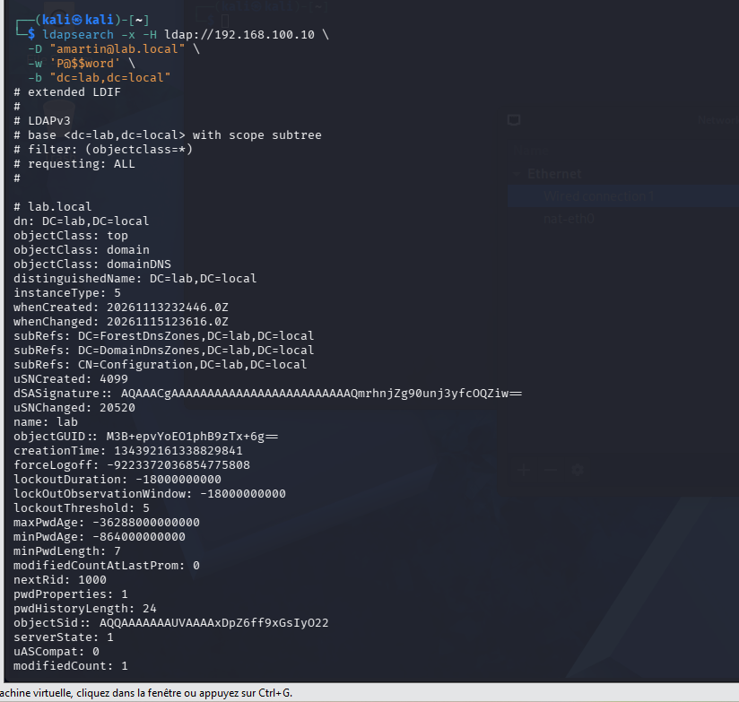

# 03 - Attaques AD

Statut : en cours. Premiere attaque menee et documentee de bout en bout (enumeration LDAP). Les techniques suivantes (LLMNR/NBT-NS poisoning, Kerberoasting, AS-REP roasting, mouvement lateral, BloodHound) seront ajoutees au fur et a mesure, selon le meme format.

Chaque technique est documentee en 4 points : **Quoi** (le mecanisme), **Comment** (reproduction + preuve), **Comment detecter** (point de vue defenseur, logs/outils), **Comment corriger** (correctif + preuve apres correction). Le resume synthetique de chaque ligne se retrouve aussi dans [matrice-attaque-defense.md](../matrice-attaque-defense.md).

## Mise en place : VM KALI-01 (poste attaquant)

KALI-01 simule un attaquant externe qui a acces au reseau mais aucun identifiant au depart. C'est une VM Kali Linux a part, **non jointe au domaine**, placee sur le meme segment reseau isole que DC-01 et WST-01 (meme logique que les autres VM : une carte isolee pour parler aux cibles, une carte NAT pour les mises a jour `apt`).

- IP isolee : 192.168.100.50/24
- Verification de la configuration reseau (`nmcli device status`, `ip -br a`) :



- Test de portee vers les deux cibles avant toute attaque, pour confirmer que KALI-01 voit bien le reseau isole :



Point technique : le statut `UNKNOWN` affiche par `ip -br a` sur l'interface `eth1` n'est pas une anomalie. C'est l'*operstate* du noyau Linux, et certains pilotes de cartes reseau virtuelles VMware n'implementent pas la detection de porteuse correctement. La preuve de fonctionnement reelle est le ping (0% de perte), pas ce champ.

## Attaque #1 : Enumeration LDAP (bind anonyme vs bind authentifie)

### Quoi

LDAP (le protocole qu'AD expose pour que les clients interrogent l'annuaire) accepte plusieurs types d'authentification pour une requete :
- **bind anonyme** : aucune identite fournie
- **bind simple authentifie** : identifiant + mot de passe en clair (ou via TLS)
- **bind SASL/GSSAPI** : authentification Kerberos directe (non teste ici)

Depuis Windows Server 2003 SP1, AD bloque le bind anonyme par defaut (attribut `dSHeuristics` sur l'objet de configuration de la foret). En revanche, **tout utilisateur authentifie, meme sans aucun privilege, peut par defaut lire la quasi-totalite de l'annuaire** : utilisateurs, groupes, appartenances, politiques de mot de passe du domaine, etc. Ce n'est pas un bug : AD a besoin que les postes clients puissent resoudre groupes/GPO au quotidien. Mais c'est la base de reconnaissance de tous les outils d'attaque AD modernes (BloodHound, PowerView, etc.) : un seul compte utilisateur compromis suffit a cartographier tout le domaine.

### Comment

Outil : `ldapsearch` (paquet `ldap-utils`, deja present sur Kali - aucune exploitation de vulnerabilite, juste l'usage normal du protocole).

**Etape 1 - bind anonyme, pour verifier la protection par defaut :**

```bash
ldapsearch -x -H ldap://192.168.100.10 -b "dc=lab,dc=local"
```

Resultat : refuse, comme attendu.



**Etape 2 - bind authentifie avec un compte standard, zero privilege (amartin, Tier2) :**

```bash
ldapsearch -x -H ldap://192.168.100.10 \
  -D "amartin@lab.local" \
  -w 'Pa@$$word' \
  -b "dc=lab,dc=local"
```

Resultat : acces complet a l'objet racine du domaine, avec des attributs qui ne devraient pas etre a la portee d'un utilisateur lambda (politique de mot de passe du domaine, dont `lockoutThreshold: 0` - voir decouverte annexe ci-dessous).



Remarque pratique (erreur reelle rencontree et corrigee pendant le test) : une premiere tentative avec un filtre `memberOf=...` a echoue avec `Invalid credentials (49)` a cause d'une faute de frappe dans le mot de passe retape manuellement (`Pa$$word` au lieu de `Pa@$$word`) :



Une fois le mot de passe corrige, le bind a reussi (`result: 0 Success`) :



Cet echec illustre un point utile pour la partie detection : **chaque tentative de bind invalide genere un evenement de securite sur DC-01**, qu'elle soit volontaire (attaque par mot de passe) ou accidentelle.

### Comment detecter

On ne peut pas empecher structurellement un utilisateur authentifie de lire l'annuaire sans casser le fonctionnement normal d'AD. La defense repose donc sur la detection :

- **Event ID 4625** (echec de logon) sur DC-01 : plusieurs echecs rapproches sur un meme compte ou depuis une meme source = signal de brute-force/password guessing.
- **Event ID 1644** (requetes LDAP couteuses/inhabituelles) : necessite d'activer le niveau de diagnostic `15 Field Engineering` sur DC-01 (desactive par defaut, car verbeux).
- En environnement professionnel, l'outil reellement utilise pour ce type de detection est **Microsoft Defender for Identity (MDI)** : il detecte nativement les patterns de reconnaissance type BloodHound/PowerView, bien au-dela d'un simple audit de logs manuel.

### Comment corriger

Il n'existe pas de correctif qui supprime completement ce risque sans casser AD. Les leviers reels :
- Restreindre la lecture de certains attributs sensibles via le bit de confidentialite (`searchFlags` / `fCONFIDENTIAL`).
- Mettre les comptes a privileges dans le groupe **Protected Users** (force Kerberos AES, bloque NTLM/delegation pour ces comptes) - prevu pour `adm-yelj` dans une prochaine iteration.
- Surveiller plutot qu'interdire (voir section detection ci-dessus).

## Decouverte annexe : absence de politique de verrouillage de compte

L'enumeration de l'etape 2 a revele que `lockoutThreshold: 0`, c'est-a-dire qu'**aucun verrouillage de compte n'etait configure** sur le domaine. Consequence concrete : un attaquant peut faire du password spraying ou du brute-force sans jamais declencher de blocage, et sans meme avoir besoin d'etre furtif.

Correctif applique immediatement :

```powershell
Set-ADDefaultDomainPasswordPolicy -Identity lab.local `
  -LockoutThreshold 5 `
  -LockoutDuration (New-TimeSpan -Minutes 30) `
  -LockoutObservationWindow (New-TimeSpan -Minutes 30)
```



Preuve avant/apres : en relancant la meme requete LDAP authentifiee apres le correctif, `lockoutThreshold` est bien passe de `0` a `5` :



## Etapes a venir

- LLMNR/NBT-NS poisoning (Responder) depuis KALI-01
- Mise en place du prealable Kerberoasting (SPN sur `svc-backup`) puis attaque (impacket)
- AS-REP Roasting
- Cartographie BloodHound
- Mouvement lateral (evil-winrm)
- Ajout de `adm-yelj` au groupe `Domain Admins` (ecart identifie plus tot, toujours pas corrige) et test de son impact sur les attaques ci-dessus
